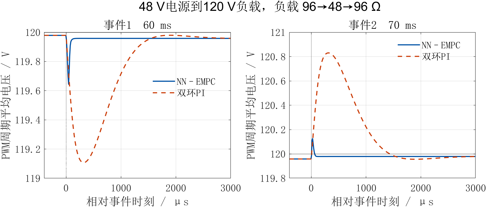
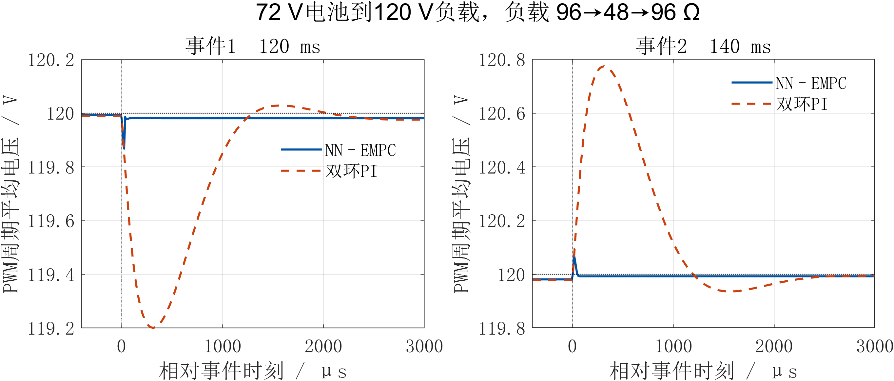
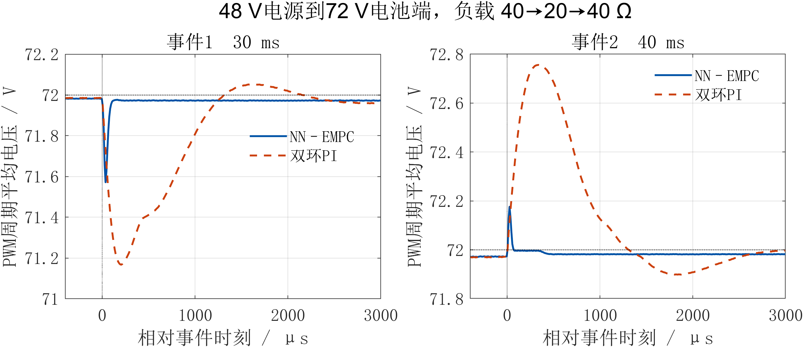
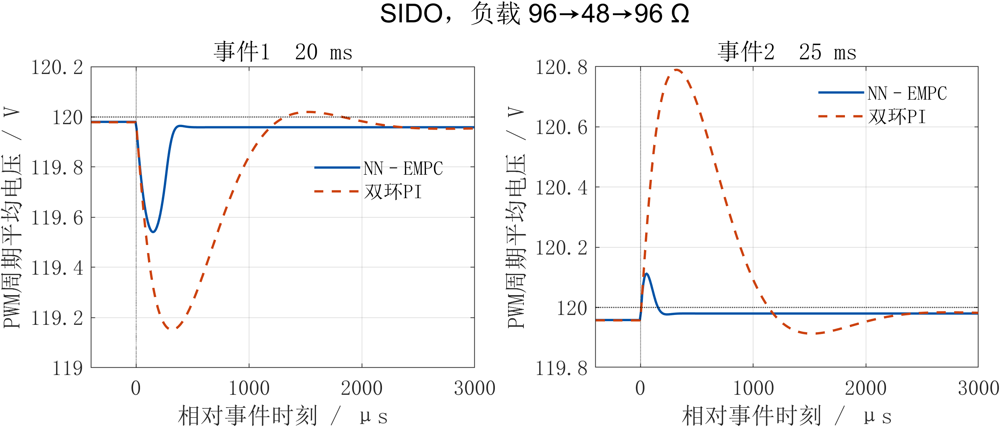
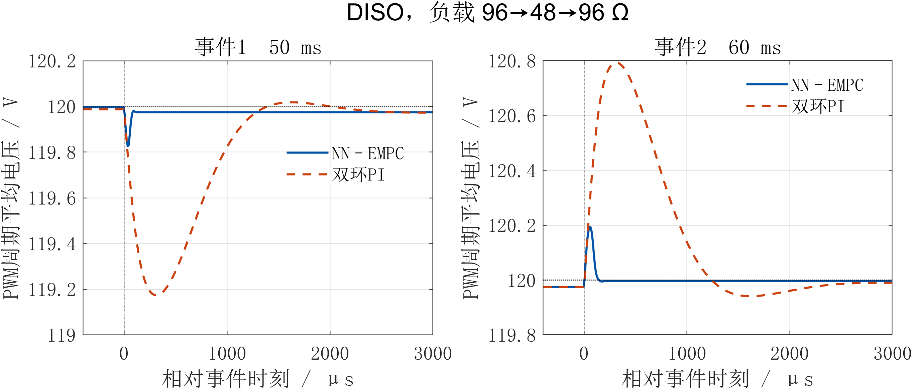
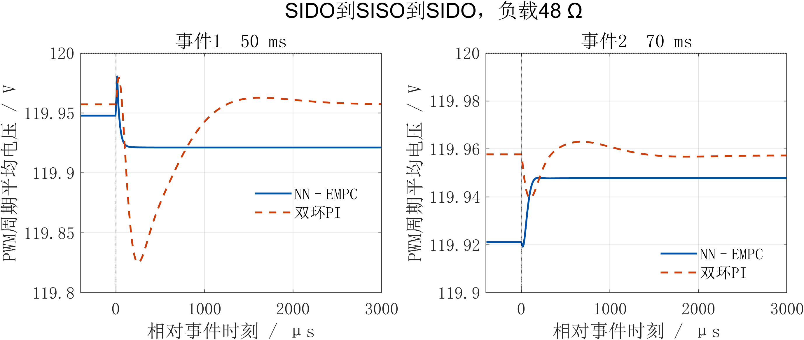
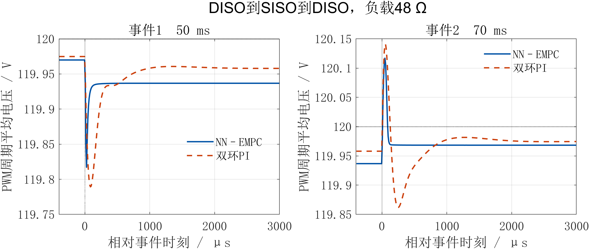
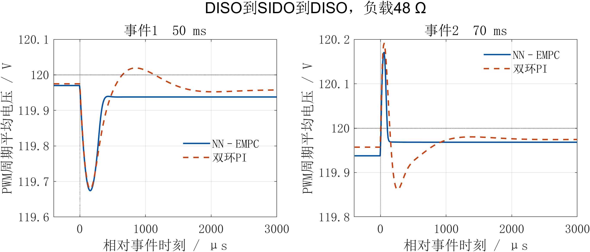
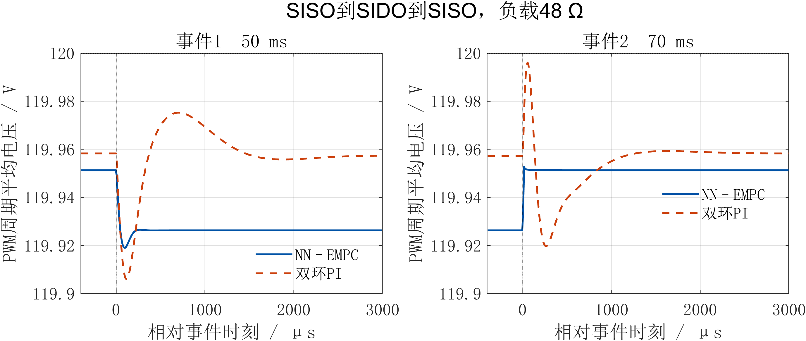

# 48 72 120 V PI与NN EMPC仿真对比

本轮在相同保存电路的独立副本上，重新运行五种单模式和四组往返切换，共18次实际开关电路仿真。五种单模式中，5种的最大变载电压偏差为NN更小；四组切换中，2组的最大偏差差异不超过0.01 V。九工况最大平台稳态相对误差分别为NN 0.0657%、PI 0.0412%。该结果描述本次两种具体实现，不代表所有PI结构或整定的上限。

| 工况 | 最大平台误差 NN/PI % | 最大事件偏差 NN/PI V | 最长恢复 NN/PI μs |
|---|---|---|---|
| Vs→Vo | 0.0347 / 0.0347 | 0.335 / 0.872 | 75 / 1225 |
| Vb→Vo | 0.0158 / 0.0175 | 0.125 / 0.795 | 35 / 1045 |
| Vs→Vb | 0.0383 / 0.0412 | 0.410 / 0.818 | 75 / 1105 |
| SIDO | 0.0347 / 0.0355 | 0.439 / 0.832 | 295 / 1025 |
| DISO | 0.0212 / 0.0207 | 0.220 / 0.818 | 95 / 1075 |
| SIDO→SISO→SIDO | 0.0657 / 0.0356 | 0.033 / 0.132 | 0 / 425 |
| DISO→SISO→DISO | 0.0527 / 0.0350 | 0.180 / 0.186 | 75 / 305 |
| DISO→SIDO→DISO | 0.0519 / 0.0356 | 0.296 / 0.296 | 295 / 355 |
| SISO→SIDO→SISO | 0.0614 / 0.0356 | 0.032 / 0.052 | 0 / 0 |

电气参数、时序、限幅与周期均值时间网格核对通过。指标排除初始化，恢复带为后平台均值±0.1 V，窗口最多3 ms。PI不用负载电流前馈，NN使用负载电流输入，比较不能单独证明预测机制的贡献。

## 48 V电源到120 V负载

## 72 V电池到120 V负载

## 48 V电源到72 V电池端

## SIDO

## DISO

## SIDO到SISO到SIDO

## DISO到SISO到DISO

## DISO到SIDO到DISO

## SISO到SIDO到SISO

