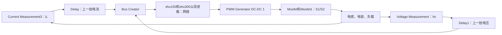

> 历史专题资料：文内原“下一步”只记录当时安排，不作为当前顺序。当前按开始这里.md与项目记忆与进度.md逐模式推进。

# 12：把原Simulink的一次控制更新串起来

第11课介绍网络怎么算d，本课回到原Vs→Vo模型；是否掌握仍需独立解释确认。**一次控制更新负责改d；PWM持续产生脉冲；电路持续响应。** 三者相连，但不是同一个动作。

使用已有教学模型和保存波形，本课未新增仿真实验。

## 1. 在模型里沿这条线找



Bus Creator还接入负载相关特征和200V参考，但本案例网络预处理删除了这两项，有效计算只使用电流、电压。

## 2. 一次更新的先后关系

**① 测量当前状态。** 电路产生当前iL、Vo，测量块输出数值。测量不是控制指令。

**② Delay输出上一拍状态。** 两个Delay长度为1，采样间隔2.5μs。因此网络用的是上一拍状态，不是直接使用刚测得的这一拍。

**③ 网络算新的d。** 归一化、40个节点、输出层、反归一化，就是第11课的计算。原网络在线不再调用A、B或EMPC求解器。

**④ PWM根据d产生门极0/1。** 有效PWM输出同时接S1和S2。

**⑤ 电路状态变化，再进入下一拍。** S1、S2开时电感储能；关时电感经二极管给输出送能。

按离散信号关系理解：

$$d[k]=NN\big(i_L[k-1],V_o[k-1]\big)$$

这不是说CPU的运算时间为零；它描述原仿真信号链中的一拍延迟。

## 3. 用你熟悉的C逻辑表示

```c
static double previous_il = 0;
static double previous_vo = 0;

// 示意原Delay与静态网络的关系，不是完整固件。
void control_update(double measured_il, double measured_vo) {
    double duty = network_duty(previous_il, previous_vo);

    previous_il = measured_il;
    previous_vo = measured_vo;

    pwm_set_duty(duty);
}
```

初值0只是说明Delay的缓存逻辑。真实上板还要核对启动、ADC完成时刻、计算耗时和PWM寄存器生效时刻，不能把这一段直接烧进去。

**PWM计数器自己一直运行，不需要这段函数每次把GPIO置1再置0。**

## 4. 原模型里，一周期不只更新一次d

PWM频率100kHz，一个周期10μs；Delay采样间隔2.5μs。因此一个PWM周期中有4个这样的采样间隔。

下面直接取自已保存的55ms附近CSV，不是编造的时间表：

| 相对55ms的时间 | 记录的网络d | 记录的门极S1=S2 |
|---|---|---|
| 0μs | 0.769640 | 1 |
| 2.5μs | 0.924967 | 1 |
| 5μs | 0.823085 | 1 |
| 7.5μs | 0.701350 | 0 |
| 10μs | 0.602392 | 1 |

看到区别了吗？d是小数指令，门极是0或1。**原模型的d在一个周期内也会变化，不能拿周期起点的某个d，直接认定整周期导通时间一定是d×10μs。**

若d整周期保持不变，才可直接用`导通时长=d×周期`理解理想PWM。嵌入式PWM常涉及更新寄存器的时机；原仿真与目标硬件怎样一致，部署步骤再核对。

## 5. 从门极看回电感


上面是门极，下面是电感电流。按每个周期看：

- 门极高：电感电流上升，电容给负载供电。
- 门极低：电感电流下降，电感给输出送能。
- 门极低不意味着电流为零，电流继续经过二极管。

这些边沿按0.1μs采样记录，只在该分辨率内读图。相邻周期宽度、电流峰值有变化，与动态控制指令相对应。

## 6. 现在整个项目主链已连起来

```text
离线：原辨识模型 → MPC → EMPC → 标签 → 网络训练 → 保存网络

在线：测量 → Delay → 保存的网络 → PWM → 开关 → 电路 → 再测量
```

离线用A、B预测和设计控制；当前在线执行已训练网络。不能在在线流程里再虚构一遍MPC和EMPC求解。

到这里你应该能讲清：数据从哪里来、控制器怎样形成、占空比怎样算、占空比怎样变成电路动作。

自查两点：

- [ ] 能区别采样更新、占空比指令与PWM门极。
- [ ] 能解释为什么这个模型不能直接叫“一周期控制一次”。

下一步到你说的文件整理环节：先只梳理SISO案例的工作区副本，列清每个文件作用、输入输出、运行入口及依赖流程图，区分已能运行的闭环与尚缺配置的重训练步骤。

[已保存的教学模型](D:/Project/NN_EMPC_TPC/我们的科研工作区/主线工程/02_仿真工程/01_SISO_VsVo/结果/门极与电流/SISO_VsVo_study.slx)


## 2026-10-12：训练完成不等于停止采样

用户回答“训练好了就不用采集”，这是尚未掌握的关键点，先纠正再进入硬件。离线训练固定权重、偏置及缩放参数；在线推理用这些固定参数处理不断更新的电流/电压，产生新的占空比。原Vs→Vo活动网络有效输入是iL和Vo，在线为一拍延迟状态，不能省去反馈。

```c
// C仅作逻辑类比，不是FPGA实现或可直接上板固件。
// prev保存上一拍已标定状态；实际采样、延迟和PWM装载时序另行验证。
float duty = nn_predict(prev.il_A, prev.vo_V);
pwm_write_shadow(duty);
prev = current_sample;
```

训练阶段收集辨识/训练数据与运行阶段持续采样反馈是两件事：不用在线重训，不代表不用在线采样。没有反馈时网络不知道负载、输入电压或状态变化，不能称为原NN-EMPC闭环。网络与硬件保护也不是同一模块。待用户能解释“固定的是参数，更新的是测量与命令”，再补SIDO/DISO增益及部署接口。
