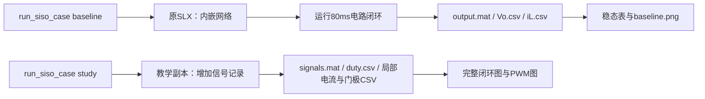
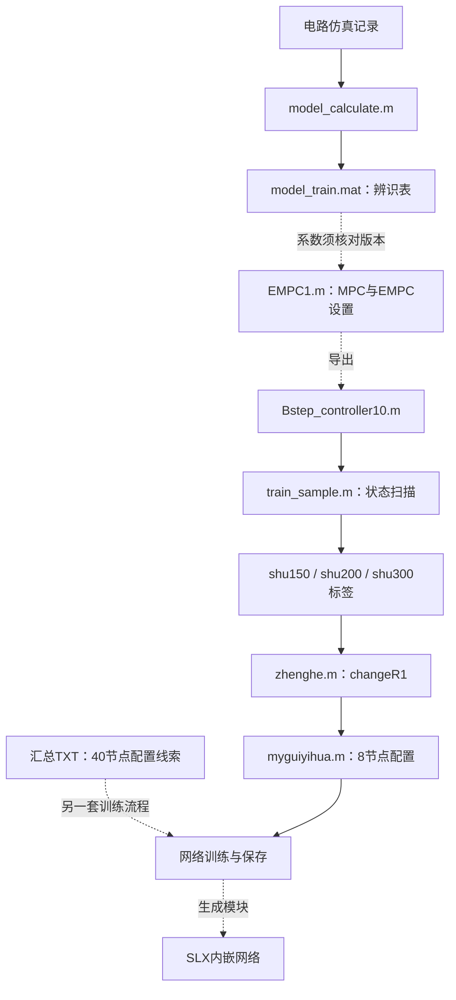

# 13：SISO的Vs→Vo案例，文件现在怎么用

本课只整理SISO的Vs→Vo（48V→200V）案例的文件、算法生成链与运行流程，不包含另外两个SISO模式的逐文件梳理。现在使用主线工程中的独立副本，原资料保持不动。

SISO共有三个模式：Vs→Vo、VB→Vo、Vs→VB。另两个模式的原理和已运行结果见第03、04课；它们的文件说明和结果指标尚未按本课及第14课的详细程度整理，不能视为已全部完成。

案例根目录：

[第01轮_SISO_VS48_Vo200](D:/Project/NN_EMPC_TPC/我们的科研工作区/主线工程/02_仿真工程/01_SISO_VsVo)

## 1. 现在先用这个入口

在MATLAB命令窗口执行：

```matlab
cd('D:/Project/NN_EMPC_TPC/我们的科研工作区/主线工程/02_仿真工程/01_SISO_VsVo');
run_siso_case('view');
```

打开已有教学模型，可以找到第12课的整条控制链。其他动作分别选择：

| 命令 | 做什么 | 输出位置 |
|---|---|---|
| `run_siso_case('help')` | 显示入口说明 | 命令窗口 |
| `run_siso_case('view')` | 打开已有教学模型，不自动仿真 | Simulink |
| `run_siso_case('empc',[10;200])` | 查询原已有EMPC函数 | 显示占空比、区域和实际函数路径 |
| `run_siso_case('baseline')` | 重跑原80ms闭环 | 结果/基线与检查/完整80ms |
| `run_siso_case('study')` | 建立测量副本、跑80ms并导出门极等信号 | 结果/门极与电流 |
| `run_siso_case('plots')` | 用已有signals.mat重画图，不重新仿真 | 结果/门极与电流 |

后三项会更新对应的结果文件，原模型副本不覆盖。入口结束后恢复原MATLAB工作目录和搜索路径。原模型需要项目已有MATLAB/Simulink、电力系统及网络工具箱环境；EMPC函数查询无需重新生成分区。

统一入口调用先前已验证的脚本。迁移后已实际验证入口与原EMPC查询，10A、200V返回d≈0.082692545；本次未重复跑80ms仿真。

## 2. 原目录里的每个文件

下面路径以“模型与算法”为起点。

| 文件 | 作用与输入输出 | 怎么用 / 当前状态 |
|---|---|---|
| `SISO_VS48_Vo200.slx` | 电路+已保存网络+PWM闭环；输出Vo、iL | 原80ms基线已跑通；用baseline入口 |
| `Bstep_controller10.m` | 输入[iL;Vo]，返回[d,region] | 统一入口固定使用根目录这一份查询 |
| `代码/Bstep_controller10.m` | 另一份同名导出控制器 | 保留来源；不与根目录函数混用，两份文件哈希不同 |
| `代码/model_calculate.m` | 将iL、Vo前后步配对；保存model_train并拟合下一步电压 | 已读懂；需要采集数组，当前不执行重采或覆盖MAT |
| `代码/model_train.mat` | 历史电路辨识数据，4000×5；含额外工作区变量 | 指定变量读取，不把整包变量混入当前工作区 |
| `代码/EMPC1.m` | A/B、约束、权重→MPC→EMPC→导出函数 | 参数设置已讲；不是运行闭环SLX的前置步骤，当前不重生成 |
| `代码/train_sample.m` | 网格查询EMPC→控制标签 | 当前配置范围0～92A、0～200V，输出shu200 |
| `代码/shu150.mat` | 历史EMPC标签191379×5 | 原标签已抽查；不是下一步电路状态数据 |
| `代码/zhenghe.m` | 拼接shu300、shu150、shu200→changeR1 | 当前案例所需文件未齐、行号有版本差异，暂不直接执行 |
| `代码/myguiyihua.m` | changeR1→8节点网络训练→评估→gensim | 是一套训练脚本，不是当前40节点网络的直接同配置复现 |
| `代码/shu150和shu300以及变载代码.txt` | 另一套汇总片段：历史采样、模型设置、标签扫描、40节点训练配置 | 重要来源线索；按段阅读，不改扩展名后整文件盲跑 |

**SLX内已保存网络，所以运行闭环不需要每次执行辨识、EMPC生成、标签生成和训练。**

读取MAT时这样做：

```matlab
s = load('模型与算法/代码/model_train.mat','model_train');
rows = s.model_train;
t = load('模型与算法/代码/shu150.mat','shu150');
labels = t.shu150;
```

MAT是数据容器，里面可能有多个变量；不要仅凭文件名认定所有变量都是要用的。

## 3. 两条流程图，对应两种使用目的

### 运行作者已经保存的控制器



### 理解或复现原算法生成过程



第二张图表示文件的用途关系，不证明现存每个文件来自同一次生成。实线也不代表缺失输入已经补齐。

## 4. 新发现的40节点TXT，怎样理解

这个TXT里有：

- 辨识表4000行、占空比0.816。
- 状态扫描到144A、214V，第三特征1.333，参考200V。
- `hiddennum=40`、两层tansig、trainlm训练配置。

这些与保存MAT和原网络结构更接近，比8节点脚本更值得沿着追踪。但是其B系数与当前历史数据回归结果仍不完全一致，文本也不是带完整训练记录、随机种子和最终权重的可复跑工程。

因此修正前面的说法：**已有40节点训练配置线索；尚未确认它能原样重建当前网络权重。** 不是没有任何40节点代码，也不能只因节点数相同就宣布训练复现完成。

## 5. 我们新增的脚本和结果，哪些现在用

| 文件/目录 | 用途 |
|---|---|
| `run_siso_case.m` | 本次新增统一入口 |
| `脚本/full_round1.m` | 原80ms基线执行和结果导出 |
| `脚本/study_signals.m` | 教学模型、duty/门极/电流记录 |
| `脚本/recover_study_plots.m` | 从保存MAT重画图；早期绘图错误已修正 |
| `脚本/audit_round1.m` | 早期环境、数据、函数来源检查，当前无需反复跑 |
| `脚本/smoke_round1.m` | 早期1ms加载试跑，80ms已完成后通常无需重复 |
| `脚本/extract_network.py` | 从原SLX提取精确权重和缩放参数 |
| `脚本/verify_network.m` | 独立MATLAB推理与Simulink/历史标签数值对照 |
| `结果/基线与检查/完整80ms` | 原基线MAT、CSV、稳态表和图 |
| `结果/门极与电流` | 测量模型、signals.mat、占空比/门极/电流和图 |
| `网络参数/network_parameters.json` | 原SLX精确参数及来源哈希 |
| `网络参数/nn40.c、nn40.h` | 已用MATLAB附带lcc64编译并与1000点原Simulink网络输出对拍；仍无ADC/PWM/保护/目标MCU计时 |
| `脚本/verify_nn40_c.py、nn40_cli.c` | 重编译C推理并做1000点数值对拍，结果为`网络参数/c_inference_comparison.json` |
| `网络参数/nn40_validation.slx` | 仅网络数值测试模型，没有功率电路 |
| `网络参数/*comparison.csv、verification.txt` | 已完成数值对照证据 |
| `结果/基线与检查/来源清单.csv、文件完整性复核.csv` | 原资料与副本来源证据 |

旧日志可能记录早期失败；判断本次结果要看对应最终完成标记和结果文件，不将一次绘图失败当成电路仿真没有运行。

**2026-10-08硬件移植前置核对：**`extract_network.py`原先把输入缩放写成`1--1`，且局部数组直接用函数参数初始化不被MATLAB附带lcc64接受；已修正生成器并重生成C源。`verify_nn40_c.py`在临时英文路径编译，对保存的1000个Simulink输入逐点调用C函数，最大绝对误差约1.166e-12，阈值1e-10通过。这个结果仅证明当前Vs→Vo的2→40→1网络前向数值移植正确，不证明控制时序、开关安全或五模式全部可上板。

## 6. 本次整理后的用法

现在只需记三个入口：**view看模型，empc查控制律，baseline或study复跑闭环。** 原生成脚本先按课件理解，到复现生成步骤再逐文件处理。

下一步把SISO主线的仿真结果讲清：启动、稳态、负载变化分别验证什么，哪些图和数据可以作为论文结果，哪些结论目前还不能写。


## 7. 本模式的预测参数与在线控制

原代码/EMPC1.m的当前设置：

```matlab
A = [0.9960 -0.0021; -0.0002 0.9996];
B = [0.7940; 0.1395];
C = [0 1]; D = 0;
```

预测状态x=[iL;Vo]，输入d；x(k+1)=A*x(k)+B*d(k)。N=20；控制分块1～5步；状态上限[92A;200V]；0≤d≤1；参考200V；Qx=diag(3,0)，Qy=3000。以上是该历史脚本版本，不直接等同于当前40节点网络的精确训练配置。

已有闭环在线用SLX保存的网络，不在线求解MPC。原网络有效输入为iL、Vo，隐藏层40节点，经缩放和tanh乘加得到占空比。测量Delay为一个2.5μs采样步，PWM为100kHz（周期10μs）；不要把两者当成同一周期。

```c
// 理解数据方向；不是可直接部署的完整固件。
float d = nn_saved(il_previous, vo_previous);
// PWM阶段：S1与S2同步，S3关断。
```

同一[10A;200V]输入，已有EMPC查询约0.082692545，原保存网络约0.104048589。它们并非该点完全相等；精确网络数值验证已做，但导出控制器、标签与权重的完整版本对应尚未闭环。


