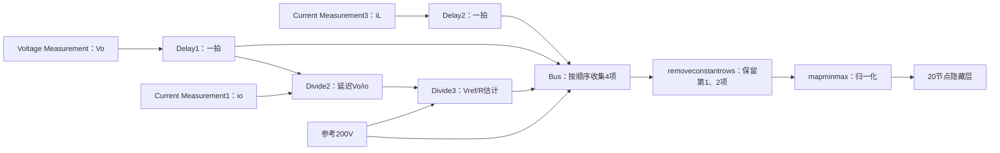
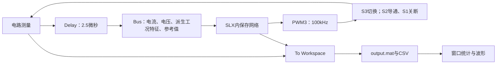

# 15：SISO，VB→Vo完整分析

先看这一个模式：72V电池端供负载，输出参考200V。本章将电路原理、文件和数据连起来。保留原基线，并针对PWM与电感电流增加细采样诊断仿真；没有重采辨识数据或重训。

**当前：第4节，负载变化→电流与电压响应→网络命令与实际PWM。前面的工程、网络计算、数据来源已讲，本轮直接接闭环结果。**

## 1. 接着03、04：现在认工程文件

[03：另外两个SISO模式](D:/Project/NN_EMPC_TPC/我们的科研工作区/主线工程/01_学习路线/03_另外两个SISO模式.md)已讲电路、两个模态和电压关系；[04：运行另外两个SISO仿真](D:/Project/NN_EMPC_TPC/我们的科研工作区/主线工程/01_学习路线/04_运行另外两个SISO仿真.md)已运行并查看波形。这些是已完成的学习基础，本课直接接工程和数据，不重讲电路。

当前模型是`SISO_VB72V_Vo200V.slx`。先认四个位置：

| 位置 | 你把它理解成什么 | 当前作用 |
|---|---|---|
| 模型与算法/SISO_VB72_Vo200/SISO_VB72V_Vo200V.slx | 电路与控制程序装在一起的工程 | 保存实际电路、测量、网络和PWM |
| SLX内的shu150和shu300变载-2.0 | 已经训练好的控制函数 | 把测量值算成占空比，实际输出接PWM |
| 代码/EMPC1.m、Bstep、train_sample、myguiyihua等 | 生成控制器与训练材料的离线工具 | 追溯“控制函数怎么来的”；运行现成SLX不要求全部执行 |
| 结果/SISO_VB72_Vo200 | 测试记录 | 保存MAT、CSV、波形和指标；已在04运行，不必为了阅读重跑 |

### 当前实际运行的是哪一条链


**在线闭环用SLX里面已经保存的网络计算d。** `EMPC1.m`是历史离线设计脚本，不能因为文件名含EMPC就认为它在每个PWM周期里被执行。`Bstep_controller10.m`用于显式控制律查询和标签生成；当前这条活动链是网络输出直接进入PWM。

用C只表达数据方向：

```c
// 说明原模型信号关系；函数名为教学占位符，不是可直接运行的固件。
float il_used = il_delayed;
float vo_used = vo_delayed;
float d = saved_nn(il_used, vo_used);
pwm_s3_request(d);
// S1保持关断，S2保持导通。
```

其中“saved_nn”对应的实际网络有效结构已从SLX核对为2→20→1；Bus虽然有4项，网络预处理仅保留iL、Vo。详细特征和历史参数放在第2节，到对应步骤再展开。

### 怎么在工程中找到它

```matlab
cd('D:/Project/NN_EMPC_TPC/我们的科研工作区/主线工程');
project_entry('vbvo');
```

这个命令打开`结果/SISO_VB72_Vo200/SISO_VB72V_Vo200V_study.slx`，是先前增加记录信号的教学模型。原工作副本仍在模型与算法目录；两者用途分清。现在只查看活动网络输出接到哪一路PWM，不必点击Run。

本步应能回答：哪个SLX是实际工程、哪个模块输出d、哪个开关接PWM，以及离线生成脚本为什么不需要在每次仿真前重跑。

**下一小步：顺着网络输入端，逐项解释测量、Delay、Bus和预处理；随后再核对这套控制器与MAT数据的来源。**

### 这一小步：测量→Delay→Bus→网络输入

2026-10-07再次只读核对原SLX根层接线，以下对应实际活动网络，不是按模块名称猜测。

| 信号 | 原模块与路径 | 到网络入口的位置 |
|---|---|---|
| 电感电流iL | Current Measurement3→Delay2 | Bus第1项 |
| 输出电压Vo | Voltage Measurement→Delay1 | Bus第2项 |
| 派生工况特征z | Delay1与Current Measurement1→Divide2，再与参考电压→Divide3 | Bus第3项 |
| 参考电压200V | 参考电压常数模块 | Bus第4项 |

**Delay1/Delay2都是延迟一个采样点，采样间隔2.5μs。** 在采样时刻k，输出相当于上一拍的iL、Vo。它们是两个量各自延迟一拍，不是两级串联延迟5μs。100kHz PWM周期是10μs，这与Delay采样间隔是不同概念。



Bus可理解为按固定顺序整理参数，不求误差、不做优化、不改变输入值。其入口四项为：

$$[i_{L,\mathrm{延迟}},\;V_{o,\mathrm{延迟}},\;z,\;200].$$

Divide2的两个输入按“乘/除”配置，所以：

$$R_{\mathrm{估计}}=\frac{V_{o,\mathrm{延迟}}}{i_o},\qquad z=\frac{200}{R_{\mathrm{估计}}}.$$

在分母有定义的情况下可写成$z=200i_o/V_{o,\mathrm{延迟}}$。例如电阻负载稳态接近300Ω时，z约200/300=0.6667A；150Ω时约1.3333A。这里是帮助理解特征含义的理想算例，不是重新测得的模型负载结论。

注意io这条原支路没有经过上述两个Delay，不能声称四个分量全来自同一拍。启动时除数可能为零，原模型已有相关警告；代数改写不能自动消除原两个除法模块的启动问题。

**关键：当前活动网络的removeconstantrows配置为inputSize=4、keep=[1 2]。** 因此虽然Bus送入四项，实际权重仅使用延迟iL、延迟Vo；z和200V被删除。不能仅凭“removeconstantrows”名字推断它每次实时判断哪些量恒定——本模型已经保存了固定保留索引。

保留的两项再归一化。以读取范围的四舍五入值说明：

$$p_1=2\frac{i_{L,\mathrm{延迟}}}{186}-1,\qquad
p_2=2\frac{V_{o,\mathrm{延迟}}}{265.6}-1.$$

这是把各自训练范围映射到[-1,1]，不是电流电压的误差计算，也不是限幅。超出范围时数值可以超出[-1,1]；真实计算要使用SLX内保存的完整精度参数。

用C对应有效数据路径，函数名仅为教学占位符：

```c
// il_prev、vo_prev代表Delay输出；初始化另按原模型核对。
float p1 = 2.0f * il_prev / 186.0f - 1.0f;
float p2 = 2.0f * vo_prev / 265.6f - 1.0f;
float d = nn20_then_restore_output(p1, p2);
// nn20_then_restore_output含隐藏层、输出层和输出反归一化。
// 这几行只解释计算关系，不代表已验证的MCU固件或完整Simulink时序。
```

本步要掌握：iL/Vo从哪里测；Delay为什么对应上一拍；Bus四项各是什么；为什么当前网络最终只算两项；归一化与限幅的区别。

下一小步沿同一网络继续：这两个归一化数如何经过20节点的权重、偏置和激活函数得到占空比，再与PWM输入对应。需要数值结论时先提取并验证原权重，不自行造一个新网络。

### 这一小步：两个输入怎样算出占空比

使用活动模块`shu150和shu300变载-2.0`原权重，未训练新网络。计算链为：

**两个归一化数p1、p2 → 20个节点各自乘加与tanh → 输出层乘加与tanh → 反归一化 → 占空比d。**

#### 1）20个节点，每个都做同一种计算

第j个节点有两个权重w(j,1)、w(j,2)和一个偏置b(j)：

$$z_j=w_{j1}p_1+w_{j2}p_2+b_j,\qquad h_j=\tanh(z_j),\quad j=1,\ldots,20.$$

权重决定两个输入怎样影响这个节点；偏置是额外的常数项。tanh将乘加结果变为[-1,1]范围内的非线性输出。这里的20个节点不是20个预测步，也不是20个不同控制器，是同一网络隐藏层的20项计算。

对应C逻辑：

```c
// 参数来自原网络；只是计算过程示意。
for (int j = 0; j < 20; ++j) {
    double z = W[j][0] * p1 + W[j][1] * p2 + b[j];
    h[j] = tanh(z);
}
```

原模块名称为tansig，其数学表达式2/(1+exp(-2z))−1与tanh(z)相同；不同浮点实现可能有微小数值误差，需要实际对照。

#### 2）把20个结果合成一个输出

输出层给每个隐藏节点一个权重v(j)，加上输出偏置bo：

$$q=\sum_{j=1}^{20}v_jh_j+b_o,\qquad s=\tanh(q).$$

当前原网络的输出层也是tansig，不能习惯性地省略为线性输出。

```c
double q = output_bias;
for (int j = 0; j < 20; ++j)
    q += output_weight[j] * h[j];
double s = tanh(q);
```

#### 3）反归一化，变成PWM需要的d

s在[-1,1]，恢复到训练输出范围[dmin,dmax]：

$$d=\frac{s+1}{2}(d_{\max}-d_{\min})+d_{\min}.$$

此网络原参数dmin约−9.07×10⁻¹⁴、dmax约1+3.70×10⁻¹³。便于理解时可近似为d=(s+1)/2；数值核对使用保存的完整精度。它不是一个额外的硬限幅模块，也没有在这里实现实物过流保护。

```c
double duty = (s + 1.0) * 0.5 * (dmax - dmin) + dmin;
```

从原权重表计算输出是前向推理；训练时才调整W、b。闭环运行此网络时不需要每拍重新求A/B、求解EMPC或更新这些权重。

#### 4）用原权重算一次：iL=10A，Vo=200V

这个例子只是检查网络计算，不表示指定的电流、电压一定处于某个负载的物理稳态。

| 计算位置 | 本例结果 |
|---|---:|
| p1 | −0.892473118280 |
| p2 | 0.506024096386 |
| 隐藏层第2节点z2 | −3.792233890561 |
| 隐藏层第2节点h2=tanh(z2) | −0.998983945975 |
| 输出层乘加q（已包含全部20节点） | −1.849083291814 |
| 输出层tanh结果s | −0.951659546557 |
| 反归一化d | **0.0241702267212** |

第2节点实际参数为w21≈1.108225116476、w22≈−6.501828864198、b2≈0.486909310756。把p1、p2代入下面一行即可对应表中z2：

$$z_2=1.108225116476p_1-6.501828864198p_2+0.486909310756.$$

这里的b2指隐藏层第2节点偏置，不是原MATLAB变量名`b{2}`；后者代表输出层偏置，本例约3.497436792787，避免按编号混淆。

d约2.417%。若仅以理想100kHz PWM换算，脉冲导通时间约0.2417μs。这里只是数学换算，未实测门极脉宽，更不说明MCU/驱动已经能可靠产生该脉冲。

**这与前面理想稳态d=0.64不矛盾：0.64由理想周期稳态条件推导；0.02417是给定状态点的网络输出。** 网络输出是否正确、闭环是否稳定，要靠标签版本和电路验证，不能只看数值计算对上。第4节已进一步测得：平均网络命令约0.604，而门极高电平占比约0.64；不能把这两个统计量直接等同。

#### 5）参数和核对数据在哪里

文件均位于既有`02_SISO_VBVo与VsVB`案例目录：

- `脚本/extract_vbvo_network.py`：只读原SLX活动网络，提取权重/偏置/缩放参数，记录源文件SHA256，用Python逐项计算。
- `结果/SISO_VB72_Vo200/network_calculation.json`：完整原参数、6组输入及每组中间计算值，不是重新生成的训练标签。
- `脚本/verify_vbvo_network.m`：把原活动网络复制到临时内存模型，对照同一输入的Simulink输出；不运行功率电路，不修改原模型。

2026-10-07已完成6组静态输入对照，最大绝对误差2.44249×10⁻¹⁵，小于预设1×10⁻¹⁰容差。`network_comparison.csv`保存逐点结果，`network_verification.txt`记录PASS；模型源文件哈希复核一致。保持iL/Vo不变、改变Bus第3/4项的一对测试输出相同，与keep=[1,2]配置一致。有限个静态输入点对照，只验证提取与计算的一致性，不能代替整个闭环、泛化或嵌入式部署验证。

本步自查：能把“神经网络计算d”解释成两层乘加+tanh+输出还原；知道权重来自当前活动模块；区分静态算例、理想稳态占空比和实际闭环波形。

下一小步：追溯当前网络与历史EMPC标签、训练脚本的版本对应，明确哪些文件能连成同一条生成流程，哪些还只是来源线索。

## 2. 实际控制链和参数

原仿真记录的门极：S1关、S2导通、S3 PWM。当前起作用的网络模块名为`shu150和shu300变载-2.0`。

这里门极结论来自先前仿真记录，不是样机测量。本次沿活动模块内部接线核对：隐藏层20节点，4个输入经`removeconstantrows`只保留[1,2]，实际使用iL、Vo；归一化范围约[0,186]A、[0,265.6]V。有效结构是**2→20→1**，而不是历史训练脚本的25节点。本模式已完成6组静态输入的独立计算与Simulink对照，最大误差约2.44×10⁻¹⁵；尚未验证整个输入域、闭环鲁棒性或部署代码。

Bus顺序已核对为：[延迟iL，延迟Vo，派生工况特征z，参考200V]。其中：

\[
$$
R_{\mathrm{估计}}=V_{o,\mathrm{延迟}}/i_o,\qquad
z=V_{\mathrm{ref}}/R_{\mathrm{估计}}
=V_{\mathrm{ref}}i_o/V_{o,\mathrm{延迟}}.
$$
\]

io来自Current Measurement1。电阻负载稳态时z近似参考电压对应的负载电流，不能当成每点真实io。当前网络删除第3/4项，**Bus接四项，不等于当前网络实际用四项**。跨负载能力须独立测试，不由模块名“变载”证明。




电路L=110μH；模型两个电容支路参数均为220μF，具体归属按接线识别，不能相加当作输出电容。电源72V，参考200V；运行200ms，120/140ms有预设负载支路开关事件。SLX中的常数0.636不等于当前活动网络始终输出0.636。

原`EMPC1.m`的预测状态是`x=[iL;Vo]`，不是沿用Vs→Vo系数：

\[
$$
A=\begin{bmatrix}0.9901&-0.0046\\0.0042&0.9999\end{bmatrix},\quad
B=\begin{bmatrix}1.475\\0.019\end{bmatrix},\quad C=[0\quad1].
$$
\]

N=20；输入分块1～11步；iL范围0～184A、Vo范围0～264V、d范围0～1；参考200V；Qx=diag(3,0)，Qy=8000。它们是历史脚本设置，不代表已经证明当前网络遵守约束。该脚本的闭环测试又传入`y.reference=0`，与前面参考200V存在需要核对的调用差异。

`train_sample.m`扫iL=0～184A、Vo=0～264V，步长0.4；五列为`[iL,Vo,0.6666,200,d]`。第三列是脚本给定的工况特征，不能直接冒充每行实测负载电流；需与Bus派生计算逐项对应。

## 3. 对应哪套文件

案例在主线工程的 `02_仿真工程/02_SISO_VBVo与VsVB`，下面路径从该目录算起。

| 文件 | 作用与输入/输出 | 当前怎么用 |
|---|---|---|
| 模型与算法/SISO_VB72_Vo200/SISO_VB72V_Vo200V.slx | 72V电源、电路、保存的网络、PWM与变载开关 | 原闭环工作副本；不是每次运行都训练 |
| 同目录Bstep_controller10.m | [iL;Vo]→显式分区控制律及区域 | 已确认与代码目录同名文件字节不同，分开追溯 |
| 同目录model_train.mat、shu300.mat | 历史辨识数据、历史控制标签的候选来源 | 已只读查看；与代码目录同名文件不同，见下表 |
| 代码/model_calculate.m | iL、Vo时序→40000×5前后步表，d固定0.636；对下一步Vo回归 | 依赖原采集数组，不能在空工作区直接运行；当前不覆盖旧MAT |
| 代码/model_train.mat | 上述辨识表的历史文件 | 已确认与根目录文件字节不同，内容见下表 |
| 代码/EMPC1.m | A/B、约束/代价→EMPC→导出Bstep | 参数如下，不直接执行以免覆盖已有控制器 |
| 代码/Bstep_controller10.m | 另一份同名显式控制器 | 与根目录版本字节不同；与本目录shu300抽查202点完全一致；与shu150不完全一致 |
| 代码/train_sample.m | 状态网格→Bstep查询→五列shu300 | 名义304721个网格点，删除含NaN行后保存；不是304721条电路采样 |
| 代码/shu150.mat、shu300.mat | 历史标签容器 | 负载/特征与导出控制器版本待对应 |
| 代码/zhenghe.m | 读取shu20、shu40→changeR | 与本目录shu150/shu300命名不匹配；不能当作本模式已跑通拼接流程 |
| 代码/myguiyihua.m | shu300前四列→25节点网络，标签为第五列 | 历史训练脚本；未证明生成当前SLX内网络 |
| 代码/shu150关键代码.txt | 含另一套A/B、shu150网格与20节点训练片段 | 已核对范围和节点线索；缺完整训练记录，不整文件执行 |
| 脚本/run_siso_pair.m | 原电路新增记录模块→仿真→CSV/MAT/波形 | 一次复跑两个模式，覆盖本工程结果 |
| 脚本/inspect_pair.py | 已有CSV与SLX→参数/峰值/窗口误差核对 | 只读已有模型和数据，生成结果/两SISO核对.json |
| 结果/SISO_VB72_Vo200 | output.mat、三条trace.csv、windows.csv、run.txt、waveforms.png、教学SLX | 读已有结果；所有数据属于仿真，不是实物实验 |
| SISO_VB72_Vo200_sources.csv | 历史复制来源记录 | 用于追溯，不是执行入口 |

### 同名数据必须分开：已查看MAT内部变量

| 位置 | 有效变量与尺寸 | 核对到的内容 |
|---|---|---|
| 根目录model_train.mat | model_train：12000×5 | 第3列固定d=0.585 |
| 代码/model_train.mat | model_train：40000×5 | 第3列固定d=0.636，与当前model_calculate脚本一致 |
| 根目录shu300.mat | shu300：113226×5 | 第3列0.6667，第4列200，状态范围约90A/200V |
| 代码/shu300.mat | shu300：296751×5 | 第3列0.666，第4列200，状态范围约184A/262.8V |
| 代码/shu150.mat | shu150：306080×5 | 第3列1.333，第4列200，状态范围约186A/265.6V |

这些有效表中的值全部有限。但代码目录两个标签MAT还含有`shuju`：其中分别保留6587和3810个非有限元素，所以不能把整包变量无选择地装入工作区。导出的核对表保留变量名、尺寸、列范围和非有限计数。

活动网络归一化范围与代码/shu150状态范围吻合，是来源线索，**不是训练来源已经确认**。代码/train_sample现在设置0.6666，也与保存shu300中的0.666或根目录0.6667不同，说明当前脚本不能直接当作全部历史数据的准确生成记录。

根目录与代码目录的Bstep、model_train、shu300均已确认SHA256不同。文件同名不代表参数、工况或标签版本相同。

只读核对证据位于本案例结果目录：`VBVo文件版本核对.json`记录路径/哈希；`VBVo活动网络结构核对.json`记录权重数量与预处理；`VBVo数据容器核对.json`记录MAT变量和数值摘要。`脚本/inspect_vbvo_data.m`可重新查看MAT，不拟合、不训练、不仿真。

### 完整串起来：辨识数据→A/B→EMPC标签→保存网络

本轮一次讲这一整条来源链。使用原文件，只读取和查询；未新采电路数据、重做辨识、重新生成EMPC或训练网络。

#### A. 两种五列表，含义完全不同

| 数据类型 | 一行五列 | 这一行回答什么问题 |
|---|---|---|
| 辨识表model_train | iL(k)、Vo(k)、d(k)、iL(k+1)、Vo(k+1) | 现在的状态和占空比，会使下一拍变成什么？ |
| 控制标签shu150/shu300 | iL、Vo、工况特征、Vref、d_opt | 面对这个状态，原EMPC选择哪个占空比？ |

```c
typedef struct {
    double il_now, vo_now, duty;
    double il_next, vo_next;
} IdentifyRow;

typedef struct {
    double il, vo, load_feature, vref;
    double optimal_duty;
} PolicyRow;
```

两个表都是五列，但第五列一个是“下一拍电压”，另一个是“控制答案”。不能互换，更不能把标签表当实测电路数据。

#### B. 辨识表提供预测模型所需的信息

原模型形式为：

$$\begin{bmatrix}i_L(k+1)\\V_o(k+1)\end{bmatrix}
=A\begin{bmatrix}i_L(k)\\V_o(k)\end{bmatrix}+Bd(k).$$

分别写开，两行各有三个待定系数：

$$i_L(k+1)=a_{11}i_L(k)+a_{12}V_o(k)+b_1d(k),$$

$$V_o(k+1)=a_{21}i_L(k)+a_{22}V_o(k)+b_2d(k).$$

所以原`model_calculate.m`从相邻采样点拼表。当前代码版本固定d=0.636、拼40000行；`regress(y,X)`取第五列作为y，实际只拟合电压这一行。**仅执行这段现有回归，不能说已经求出了完整A/B。** 电流行还需对应其来源。

根目录12000行/d=0.585、代码目录40000行/d=0.636、TXT描述13333行/d=0.6455，是三个不同历史线索。TXT还记录了0.02s与1.5μs，不能直接套用当前闭环2.5μs的Delay步长。离散系数和采样周期要配套核实。

固定占空比轨迹可提供当前工况的拟合信息，但不能仅凭这一轨迹的拟合误差证明整个占空比范围都预测准确。当前只登记该验证缺口，不另开新的辨识实验。

#### C. A/B提供预测，EMPC提供控制答案

有了模型，还要指定参考值、状态/输入限制、预测时域和权重，才形成控制问题。只给A/B不会自动得到“最佳占空比”。

离线EMPC把状态范围分成区域，每个区域保存控制规律。运行导出的Bstep函数时，先判断输入在哪个区域，再计算该区域的占空比。

```c
// 对应原标签脚本中的查询关系；不是在这里重新求解MPC。
d_opt = original_empc(il, vo);
row = { il, vo, load_feature, vref, d_opt };
```

网格里的iL、Vo是主动枚举的查询点，不一定是某一次闭环运行经过的连续轨迹。落在导出函数有效域外时，原Bstep可返回NaN；原脚本随后删除含NaN的行。有效标签数比网格总数少，不等于丢了实测采样点。

#### D. 已有文件并非只有一套配置

| 参数 | 代码/EMPC1.m | 代码/shu150关键代码.txt |
|---|---|---|
| A | [0.9901,-0.0046;0.0042,0.9999] | [0.9969,-0.0035;0.0024,0.9999] |
| B | [1.475;0.019] | [1.1;0.0166] |
| 状态上限 | [184;264] | [186;266] |
| N/控制分块/参考 | 20 / 1～11 / 200V | 20 / 1～11 / 200V |
| Qx / Qy | diag(3,0) / 8000 | diag(3,0) / 3000 |
| 网络训练线索 | myguiyihua.m读shu300，25节点 | TXT含20节点、两层tansig、trainlm片段 |

TXT状态网格665×466=309890点，按0.4步长覆盖iL到186A、Vo到265.6V，与代码/shu150.mat内原始shuju行数和范围吻合；删3810个不可行查询后，shu150剩306080行。当前网络的输入归一化范围、输出还原范围和20节点结构也与这条线索相符。

**因此找到了更接近当前网络的20节点配置线索。** 但TXT片段中的a1从哪里装入、打乱种子、实际训练划分、最终保存权重等记录仍不完整，不能把TXT当作已经验证的一键重训脚本。相同节点数也不保证相同权重。

#### E. 实际查询：哪个控制器对应哪份标签

2026-10-07分别加载本目录两份原Bstep，并核实MATLAB实际调用路径。在每张有效标签表中取101个覆盖行序的点，再增加最多101个非饱和标签点，去重后得到201/202点。对这些原行逐点查询，匹配容差为1×10⁻⁹；未重写任何训练文件。

| 原标签 | 查询控制器 | 抽查点数 | 有限输出 | 与原标签匹配 |
|---|---|---:|---:|---:|
| 根目录shu300 | 根目录Bstep | 201 | 201 | **201** |
| 代码/shu300 | 代码/Bstep | 202 | 202 | **202** |
| 代码/shu150 | 代码/Bstep | 202 | 174 | 95 |
| 代码/shu150 | 根目录Bstep | 202 | 42 | 36 |

前两组所有抽查点误差为0，支持各自目录内的对应关系；不是遍历全表证明，更不能证明是哪次训练使用了它们。现有两份Bstep都不能在本次抽查上完整复现shu150，因此其准确导出版本仍未定位。

记录：`脚本/audit_vbvo_labels.m`，以及`结果/SISO_VB72_Vo200/label_source_summary.csv`和`label_source_samples.csv`。后者保存原始行号、实际查询值、区域编号、网络输出和误差，能回到原MAT查同一行。

#### F. 网络学的是标签中的控制答案

训练时给网络前四列，调整W和b，让输出接近第五列d_opt。预处理可能删除训练时恒定的输入列。当前保存网络只保留iL、Vo，而训练脚本里写四维输入，两者要通过保存的预处理一起解释。


本次还将已提取的保存网络与同一批历史标签比较：

| 历史标签抽样 | 平均占空比绝对差 | 最大绝对差 |
|---|---:|---:|
| 根目录shu300，201点 | 0.139395 | 约1.000000 |
| 代码/shu300，202点 | 0.047086 | 0.210801 |
| 代码/shu150，202点 | **0.001584** | **0.018743** |

在这批点上，网络明显更接近shu150。结合20节点TXT和归一化范围，它是更有根据的来源方向，但**接近不能证明训练来源**。三组点不完全相同，也不是独立随机测试集，不能把本表写成泛化性能排名或控制器优劣结论。

训练脚本把全部样本送入train，又从同批样本截取手工测试集；MATLAB可能另有内部划分，但该手工评估不能直接认作独立测试。新研究需要按未见工况或独立数据划分验证，这留到对应研究步骤实施。

#### G. 现在我们真正掌握到哪一步

- 已有保存网络的原权重和6点前向数值对照，能够解释它怎样计算d。
- 两份shu300各自与本目录Bstep的抽查吻合，不能跨目录混用。
- 找到20节点/同归一化范围的shu150训练线索，原网络在抽样点也更接近这套标签。
- A/B全部来源、离散步长、shu150对应的确切Bstep和最终训练记录仍未全部连上，不能宣布从采样到最终权重的精确复现完成。

下一步回到本模式已保存的闭环波形：把网络输出、实际PWM、120/140ms负载事件和电压/电流响应对应起来，并继续核对平均占空比与理想稳态值的差异。来源缺口留在本模式台账，不以重训一个新网络替代原来源。

## 4. 已有结果逐项读

### 先把负载事件与响应对应起来

原SLX接线已核对：固定300Ω支路为Series RLC Branch3；另一条300Ω支路Series RLC Branch6经Mosfet3、Mosfet4串联接入。Step在120ms使Mosfet3导通，Step1在140ms使Mosfet4关断，因此附加支路只在120～140ms期间接入。

名义负载为300Ω→约150Ω→300Ω。中间约150Ω来自两条300Ω并联；辅助MOS导通电阻各0.1Ω等非理想参数使有效值不严格等于150Ω。Current Measurement1位于两条电阻支路的公共端，测的是总负载支路电流，不是仅固定300Ω支路的电流。

先用200V作理想量级估算：

| 时段 | 名义负载 | 负载电流Vo/R | 负载功率Vo²/R |
|---|---:|---:|---:|
| 120ms前 | 300Ω | 约0.667A | 约133.3W |
| 120～140ms | 约150Ω | 约1.333A | 约266.7W |
| 140ms后 | 300Ω | 约0.667A | 约133.3W |

这些是按目标200V与名义电阻计算的参考量，不是重新采得的实测功率。实际值由对应电压、电流记录计算。

负载加重时，输出需要更多能量，因此观察到电感平均电流升高。旧基线指定窗口里，平均iL从约2.00475A变为3.86945A，再回到2.00485A；网络平均输出从0.60345变为0.64660，再回到0.60346。输出平均值仍接近200V。

这一步要把两件事同时看见：供给负载的电流/功率增加了；控制过程是否把电压保持在参考附近，还要看下面的暂态和稳态指标。电压平稳不代表电流和占空比都不变。


| 窗口ms | 平均Vo/V | 平均误差/V | 采样峰峰值/V | 平均网络输出d |
|---|---:|---:|---:|---:|
| 115～119 | 200.03394 | +0.03394 | 0.01848 | 0.60345 |
| 125～129 | 199.88123 | -0.11877 | 0.03356 | 0.64660 |
| 145～149 | 200.03392 | +0.03392 | 0.01848 | 0.60346 |

80,001个采样点，间隔2.5μs。电压峰值270.16979V在1.25ms，超调35.0849%；电感峰值245.88806A在1.0975ms。启动和稳态必须分别评价。

120～123ms输出采样范围199.86610～200.04304V；140～143ms为199.88118～200.04302V。这是固定3ms窗口的极值，不是恢复时间，也不是完整时段最大纹波。

理想CCM推导d=1-72/200=0.64。下面直接核对门极信号，解释为什么不能拿网络平均输出0.603代替实际导通比例。


### 网络命令d，不等于门极高电平占比

2026-10-07针对这一疑点做了诊断复跑：沿用工作副本的电路、网络权重、控制设置和200ms运行时间；仅增加测量模块，并将求解器MaxStep从auto改为0.1μs，记录间隔也为0.1μs。原SLX未保存修改，SHA256复核一致；旧基线文件保留。**这批是新产生的诊断仿真结果，不是原作者保存数据，也不是新辨识/训练数据。**

| 统计窗口 | 平均Vo/V | 平均iL/A | 网络命令平均值 | S3高电平占比 |
|---|---:|---:|---:|---:|
| 118～119ms，轻载 | 200.0329 | 2.1351 | 0.60361 | 0.6400 |
| 128～129ms，重载 | 199.8796 | 4.0130 | 0.64708 | 0.6490 |
| 148～149ms，恢复轻载 | 200.0329 | 2.1351 | 0.60361 | 0.6381 |

门极占比是0.1μs采样的统计估计，不是精确边沿测量。轻载两窗口的末位差异不用于论证控制器性能优劣；本次也没有完成求解器步长收敛验证。

**先区分两个问题：网络“给了多少”，与开关“实际开了多久”。**

$$\bar d_{\mathrm{cmd}}=\frac{1}{T_w}\int_{t_0}^{t_0+T_w}d_{\mathrm{cmd}}(t)\,dt,\qquad
D_{\mathrm{gate}}=\frac{1}{T_w}\int_{t_0}^{t_0+T_w}\mathbf{1}_{g_3(t)>0.5}\,dt.$$

前者平均的是浮点命令，后者平均的是0/1门极状态。只有在相应PWM实现和更新条件满足时，二者才可等同。原模型的Delay采样为2.5μs，PWM周期为10μs，一个周期内可有多次命令更新；轻载窗口命令实际在约0.444～0.854之间变化，并不是整个周期固定0.604。

C语言类比，只表达统计口径，不代替原PWM内部实现：

```c
// 对同一窗口、等时间间隔的记录做统计。
double command_sum = 0.0;
unsigned gate_high_count = 0;
for (unsigned n = 0; n < count; ++n) {
    command_sum += command[n];       // 网络给PWM的浮点数
    gate_high_count += gate[n] > 0.5; // 实际门极是否高电平
}
double mean_command = command_sum / count;
double effective_duty = (double)gate_high_count / count;
```

当前直接测得两者不同，已经解释了为什么不能拿0.603直接否定理想0.64。精确到每个边沿的PWM更新机制仍需进一步核对；不能声称已经完全解释全部数值偏差。后续MCU若改成每周期只更新一次比较值，会改变控制时序，不能当作无差别照搬。

### 电感有没有进入断续导通？以波形为准


左列是电感电流，右列是S3门极；从上到下分别为118、128、148ms起的几个开关周期。轻载电流最低约0.0818A、最高4.1881A；重载最低约1.9254A、最高6.0671A。三个1ms统计窗口内都没有采到|iL|<0.01A的点，显示的细波形也没有零电流平台。

所以，**本次窗口不支持“0.603是因为断续导通”的解释。** 前面曾按理想参数怀疑轻载DCM，这只是待验证假设，现在不能当作结论。轻载靠近零电流边界，但本次有限窗口/步长也不能证明所有工况永远CCM。尤其不能把变化中的命令平均值代入“每周期固定占空比”的理想DCM公式后，因数值接近就认定模式。

### 为什么之前说平均电流2.00A，现在约2.14A？

旧基线每2.5μs记录一次，100kHz下每周期仅4点；新诊断每周期约100点。采样相位固定时，简单平均几个点不一定等于波形的时间平均，峰值也可能漏掉。

为避免把差异全归因于求解器，我们在**同一条新轨迹**上比较：118～118.05ms的500点平均电流为2.13506A；只取每25个点中的第1点、等效2.5μs采样，20点平均变为2.00752A。这直接说明采样口径足以造成明显差异。旧基线与新诊断还存在求解器设置差异，不能把全部残差都说成采样造成。

因此旧基线不删除、不悄悄替换；做电感峰值/RMS、器件应力和功率分析时，要先保证波形记录足够细。这一轮不把稀疏采样的峰值当作真实最大应力。

### 把负载变化讲成一条闭环过程

1. 120ms接入附加支路，所需负载电流增大；理想200V下约从0.667A升到1.333A。
2. 电感电流不能瞬间跳变，输出电容暂时承担供需差额。用输出节点关系理解：$C_o\,dV_o/dt=i_{\mathrm{送入输出端}}-i_o$；这里的送入电流不等于所有时刻的iL。
3. 测量变化经过Delay进入原网络，网络改变命令，PWM形成实际开关序列，电感能量输送随之调整。不要把该网络描述成只看电压误差的PI。
4. 新平衡下平均电感电流约4.01A，输出仍约199.88V；140ms撤去支路后恢复轻载状态，平均电感电流约2.14A、输出约200.03V。

这段机制解释与已测稳态趋势一致，但不据此声称逐瞬间能量分配已测完，或给出未经定义的恢复时间。变载过程接近200V也不抵消原基线启动270.17V、245.89A的异常；启动要单独分析。

### 本轮文件与自查

沿用本案例现有脚本/结果目录，没有另建课程目录：

| 文件 | 用途 |
|---|---|
| 脚本/check_vbvo_cycles.m | 临时加记录、细化步长，运行后关闭且不保存原SLX；执行会更新下列诊断结果 |
| 结果/SISO_VB72_Vo200/cycle_windows.csv | 三个1ms窗口的电压、电流、命令、门极统计 |
| 同目录cycles_window1～3.csv | 每个状态50μs的细波形，可逐点复核 |
| 同目录switching_cycles.png、cycle_check.txt | 波形与本次诊断设置说明 |

自查四件事：能说清300Ω→150Ω→300Ω为何改变电流；能区分网络命令和门极占比；知道4点/周期为什么不足以看峰值；知道稳态接近200V不等于启动和硬件应力合格。

### 启动：约束写在哪里，实际发生了什么

这里沿用原参数200ms基线的`port_trace.csv`、`current_trace.csv`、`duty_trace.csv`，采样间隔2.5μs；对已有数据重新统计，没有修改控制器或重新训练。启动电流和电压峰值均为**采样峰值**，真实开关瞬间极值可能更高，需要更细记录才能用于器件选型。

| 时间 | 基线采样记录 | 该点的意义 |
|---|---|---|
| 0～0.2ms | 网络命令平均约1 | 启动初段近乎满命令，但不能据此断言门极100%高 |
| 0.3875ms | iL=184.45A、Vo=16.89V | iL首次采样超过历史EMPC设置的184A上限 |
| 1.0975ms | iL最高245.89A、Vo=182.52V | 电感先出现大电流峰值 |
| 1.2125ms | Vo=264.46V、iL=68.62A | Vo首次采样超过历史264V上限 |
| 1.2500ms | Vo最高270.17V、iL≈0.24A | 电压峰值滞后于电流峰值约0.1525ms |

iL超过184A的记录持续304个采样点，约0.760ms采样总时长；Vo超过264V有1406点，约3.515ms采样总时长。这些是按2.5μs离散记录统计，不是精确越界持续时间。Vo相对200V目标的采样超调为$(270.16979-200)/200\approx35.08\%$。若将恢复定义为“启动峰值之后，直到115ms变载前，持续留在196～204V的±2%带内”，最后一次出带后的首个采样约为45.0ms；这个定义和检查区间必须随数字一起引用。

**约束要看它作用于哪个环节。** 历史`代码/EMPC1.m`设$i_L\in[0,184]$A、$V_o\in[0,264]$V、$d\in[0,1]$，这些用于离线预测控制器设计和导出标签。当前SLX在线活动环节为`测量→Delay→保存网络→PWM3→S3`，并未每拍求解带这些状态约束的EMPC。网络的输入归一化训练范围约0～186A、0～265.6V，是数值变换范围，也不是实时过流/过压保护。启动峰值均越过相应历史上限及网络输入范围。

可以用嵌入式类比：离线生成控制表时限制`i_pred <= 184`，并不会让下面的执行代码自动拥有过流中断：

```c
float duty = saved_nn(il_prev, vo_prev);
pwm_s3_request(duty);   // 现有在线链的概念示意
// 真机还需独立核对：电流比较器、关断路径、故障锁存及复位等。
```

这**不是证明EMPC的约束算法本身无效**。原因可能涉及当前网络近似误差、状态跑出训练/可行域、离散预测模型与实际开关电路不一致、启动条件、PWM时序及没有在线硬保护；现有结果不能把峰值唯一归因于某一项。原运行日志还记录启动时`Divide3`除零警告，虽当前保存网络删除Bus第3项，但该支路仍在模型里执行；需在后续启动修复时一起处理。

本步验证结论：**原闭环能把输出最后调到200V附近，但启动已采到超过历史EMPC状态上限的电流和电压，不能按这些上限宣称保护有效。** 下一次做样机参数和器件应力前，要细采样启动开关波形，并设计可验证的独立保护与软启动；这属于后续工作，不拿现在的历史参数直接上板。

证据：`结果/SISO_VB72_Vo200/startup_analysis.json`记录统计定义、关键采样点和模型哈希，原三条CSV是可复查的数据源。自查时应能解释：为什么电流峰值先于电压峰值；为什么离线状态约束不等于在线硬保护；为什么200V稳态不能给样机启动放行。

### 启动异常的直接链条：零初值→满命令→先冲电流→后冲电压

再核对原SLX参数：110μH电感的`InitialCurrent=0`；两只220μF电容支路的`InitialVoltage=0`。不能把两只电容不看接线直接相加，但可以确认模型从未预充的状态启动。72V输入从一开始存在，输出参考固定200V。

提取当前**保存网络**的真实权重后，给它$(i_L,V_o)=(0,0)$，输出$d\approx1.00000000000037$。这个数值略大于1仅来自保存的输出反归一化端点舍入；不应把它当成有意超出100%的控制。原200ms基线的启动波形也记录0～0.2ms网络命令平均为1。直接从**已有**`output.mat`读取门极记录，得到：

| 启动时段 | 平均网络命令 | S3门极高电平采样占比 | 该段电感电流范围 | 输出电压范围 |
|---|---:|---:|---:|---:|
| 0～0.2ms | 1.000 | 1.000 | 约0～110A | 约0～9.14V |
| 0.2～0.4ms | 0.974 | 0.975 | 111～188A | 9.26～20.21V |
| 0.4～0.8ms | 0.555 | 0.694 | 186～201A | 22.34～162.06V |
| 0.8～1.2ms | 0.710 | 0.756 | 95.7～246A | 163.98～258.92V |

两列门极统计都来自每2.5μs仅4点/周期的**原保存结果**，足以辨认启动初段接近持续高电平的趋势，不足以当成精确占空比或开关应力波形。启动详细门极统计见`脚本/inspect_vbvo_startup_gate.m`和`结果/SISO_VB72_Vo200/startup_gate_summary.csv`；脚本只读取原`output.mat`，不重跑电路。

能量按开关周期先进入电感、再送到输出和电容。于是本次记录呈现很直观的先后关系：**启动初段网络给近满命令，电感电流先快速升高；输出电压随后升高并在电流峰之后达到270V。** 110μH电感在245.89A时，按$E_L=Li_L^2/2$计算的瞬时储能约3.33J；这是由采样峰值算的能量量级，不等于已经证明3.33J全部流入输出电容。

这里找到了**与启动冲击直接对应的已测控制行为**，但尚不能断言“只有满命令这一个原因”：原网络在电流超过约186A或电压超过约265.6V时已离开其保存的输入归一化范围，模型时序、器件与初始条件都可能影响峰值。要判断哪种修改真正有效，后续应在工作副本中逐项对比软启动、限流和在线关断，先保存原基线，再看全程峰值与200V调节是否同时改善；不能只把启动曲线调平就宣称EMPC约束实现了。

用C理解控制缺口：

```c
// 原保存网络在零电流、零输出电压附近给出约1的命令。
float duty = saved_nn(il_prev, vo_prev);
pwm_s3_request(duty);
// 如果要限制真实启动电流，还需要独立的启动策略和可验证的故障关断路径。
```

**本轮按第6节收口：这份原模型与关键数据已能追踪和讲解，科研级算法复现、启动修复与样机验收仍分别保留未完成状态。接着按主线进入16的Vs→VB。**

## 5. 怎么运行、还差什么

```matlab
cd('D:/Project/NN_EMPC_TPC/我们的科研工作区/主线工程');
project_entry('vbvo');       % 打开已有测量教学模型
project_entry('run_pair');   % 复跑两个SISO；只需复跑时使用
```

数据链：电路测量→output.mat→时间/电压/电流/占空比CSV→windows.csv与核对JSON→图和表。CSV的时间列由原记录脚本按固定2.5μs生成；门极每周期约四点，只适合确认逻辑，不能精确测边沿。

对照论文图4-9/10，目前补上了文件作用、原脚本参数和已有波形的指标；**最终权重的训练来源、MAT生成来源、工况特征的完整版本对应、器件应力和论文原图数值对应仍未验收。**

此外训练脚本将全部样本送入train，再拿290000行以后的同批样本测试；MATLAB内部可能另有自动划分，但这不能证明该手工测试集独立，手工测试集不是独立留出集。后续新研究必须独立划分，现有误差不能直接称作泛化成绩。

自查：能指出控制S3的实际模块、辨识表与标签表的区别、CSV数据去向，并解释为什么200V附近稳态不等于启动合格。本模式各项核对完成后，再分析Vs→VB。

## 6. 本模式的科研验收

| 项目 | 需要做到 | 当前状态 |
|---|---|---|
| 电路与两个模态 | 能画回路、说明器件状态与电感/电容行为 | 基础原理已讲；按原图与模型继续核对 |
| 公式与参数 | 变换比、电流、纹波、峰值/RMS应力、器件与L/C取值依据 | 变换比已讲，完整应力/损耗/选型尚待补齐 |
| 模型与控制 | 状态、离散步长、A/B出处、约束、权重、EMPC及活动网络一一对应 | 主要历史参数已整理，精确版本对应仍有缺口 |
| 代码与数据 | 每个文件的输入/输出、依赖、数据来源、训练划分及结果去向 | 已有说明；尚未核实的MAT与训练来源继续登记 |
| 仿真验证 | 启动、稳态、变载、有效占空比、参数变化和边界 | 基线、细采样变载/PWM、启动约束越界及初段满命令已核对；启动改进、步长收敛及边界验证未完成 |
| 实物与论文证据 | 驱动/采样/时序/保护、实时性、实测、公平对比 | 尚未实施，不用仿真代替实物结论 |

### 这一轮的阶段性验收结论

| 层次 | 本轮结论 | 下一次真正需要做什么 |
|---|---|---|
| 原模型运行与讲解 | **已完成第一遍复现**：原工作副本运行200ms；S3活动网络、输入、PWM、300Ω↔约150Ω事件、稳态与启动数据均有可追溯证据 | 现成运行入口和源哈希保留，后续改进需与此原基线对比 |
| 从数据到最终网络的精确再生成 | **未完成**：辨识A/B、shu150对应导出器、最终训练记录未完全一一对应 | 补齐源数据、采样周期、标签/训练版本；再谈“从零完整重训成功” |
| 控制效果和约束 | **稳态可用作观察，启动未通过**：200V附近稳态成立，启动采样峰值约246A/270V，历史上限184A/264V没有在线硬保护保证 | 工作副本做软启动、限流/故障关断，对比全程峰值、恢复及稳态；细采样和步长收敛 |
| 样机与论文证据 | **未完成**：当前全是仿真；器件应力/RMS、损耗、实时性和实测缺证据 | 样机设计和实验阶段按可测指标补，不能把原仿真当实测 |

“已运行”“已理解控制链”“精确再生成”“科研验收”“硬件验证”是不同状态。为了快速推进，未解问题保留在本章和覆盖清单，下一模式按同样证据标准继续；不会用一个新训练网络冒充原网络。

后续内容直接补进本章相应位置，已理解的部分不用反复阅读。只有上述相关项完成并解释差异，才标记本模式验收完成。

### 2026-11-04 旧 72→200 V 参考的 FPGA 台架实现

原活动网络已接入 FPGA 的 ADC→定点推理→S3 PWM 链路。低压模拟输入验证、窗口限幅及原 SLX 与 FPGA 的采样节拍差别见台架说明。[E 上板验证](D:/Project/fpga_历史工程_20261103/20261104_正式基线整理/FPGA/旧E_vbvo_bench/上板验证.md)

前轮 E 移植的是旧 72→200 V 参考模型的 2→20→1 tansig 网络。该 bit 只用于旧参考复现，已移出正式上板验收清单。正式 VB→Vo 使用 72→120 V 工况及 4→16→8→1 ReLU 网络。 正式控制模型及参数以用户于 2026-11-04 指定的目录为准。 [48_72_120_C220_16_8](D:/Project/NN_EMPC_TPC/48_72_120_C220_16_8)
