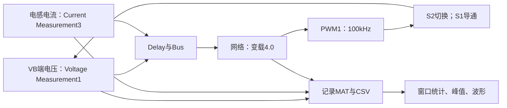

# 16：SISO，Vs→VB完整分析

这一模式是48V电源向VB端送能，受控端参考72V。**当前原仿真端口是RC负载模拟，不能当作真实电池充电实验。** 本课继续工程、活动网络、原数据与闭环结果分析。

## 1. 已有基础与本课范围

[03](D:/Project/NN_EMPC_TPC/我们的科研工作区/主线工程/01_学习路线/03_另外两个SISO模式.md)已讲Vs→VB的电路、两个模态和公式，[04](D:/Project/NN_EMPC_TPC/我们的科研工作区/主线工程/01_学习路线/04_运行另外两个SISO仿真.md)已运行对应模型。这里不重复电路课。

本课接着核对Vs→VB的工程文件、活动控制链、参数、数据来源和已有结果。15已完成原模型运行与关键链路第一遍核对，未解的启动修复和精确再生成保留在15。原理需要查阅时回到03；04已验证的仿真可直接作为已有证据使用。

### 当前第一步：先认清这次闭环控制什么

| 项目 | 从原模型/基线直接核对的答案 |
|---|---|
| 输入电源 | 48V；受控端参考72V，记录的是`Voltage Measurement1`给出的VB端电压 |
| 被反馈的状态 | `Current Measurement3`的电感电流经Delay2；VB端电压经Delay；两者进入Bus和保存网络 |
| 正在运行的控制器 | `变载4.0（最好）`保存网络，输出送`PWM Generator (DC-DC)1` |
| 实际开关 | PWM1→Mosfet1（按本工程编号S2）；S1的门极记录恒为1；S3根层门极未连接 |
| 仿真时长与事件 | 50ms；30ms/40ms有预设支路切换；当前保存的结果在`结果/SISO_VS48_VB72` |

这五项来自原SLX根层连线、显式参数和已保存`run.txt`，不是仅按文件名猜的。“给电池充电”是工作方向，当前72V端实际用RC网络模拟；所以先讲**受控端电压稳压**，不能直接宣称真实电池充电电流、SOC或恒流恒压过程已经验证。

用C类比这条在线链，函数名只是逻辑示意：

```c
float il_used = il_delay_2p5us;
float vb_used = vb_delay_2p5us;
float z = 72.0f * measured_i7 / vb_used; // 分母为零需单独处理
float d = saved_nn_vsvb_from_bus(il_used, vb_used, z);
pwm_s2_request(d);
// S1保持导通；真实S3驱动状态不能凭仿真中的未连接门极推定。
```

**和15相比，先换“谁供电、测哪一端、驱动哪个开关”，再分析其网络输入/权重/标签，不能拿VB→Vo的200V、电流范围或S3控制配置直接套过来。** 本步自查：能在模型中指出`Voltage Measurement1→Delay→Bus→变载4.0→PWM1→Mosfet1`；能解释为什么结果CSV的`port_trace`是VB而不是Vo。

下列第2～4节已继续核对Bus、当前网络、历史数据与波形；按顺序阅读即可。

## 2. 控制哪一个量、哪一个开关

活动网络模块`变载4.0（最好）`输出到PWM1，驱动S2；S1保持导通。S3门极原模型未连接，未记录独立门极，不能将“未接”当作完整的实物关断驱动设计。



L=110μH；两个C支路参数各220μF，按节点识别各自位置；Delay长度1、采样2.5μs。运行50ms，30/40ms触发负载支路事件。不能看见脚本变量叫Vo就认为它测右侧负载端：本案例port_trace是VB。

原`代码/EMPC1.m`：

\[
$$
x=[i_L;V_B],\quad
A=\begin{bmatrix}0.9975&-0.0058\\0.0043&0.9996\end{bmatrix},\quad
B=\begin{bmatrix}1.30\\0.015\end{bmatrix},\quad C=[0\quad1].
$$
\]

N=20，输入分块1～11步；iL≤86A，状态电压≤114V，输出约束≤116V；0≤d≤1；参考72V；Qx=diag(3,0)，Qy=3000。脚本闭环测试又传入`y.reference=0`，需要核对与72V参考设置的调用关系。

标签脚本扫描iL=0～85A、电压0～116V，间隔0.2，共247506个名义网格点，再滤NaN。状态扫描电压上限116V与EMPC状态约束114V不同，可能出现不可行查询，须核对。输出五列`[iL,电压,1.8,72,d]`，保存shu40。第三列是固定工况特征，不是每点实测电流。

### Bus四项，网络实际保留三项

根层信号接线和保存网络内部预处理已核对：

| Bus位置 | 信号来源 | 当前网络是否使用 |
|---|---|---|
| 1 | `Current Measurement3→Delay2`：上一拍iL | 是 |
| 2 | `Voltage Measurement1→Delay`：上一拍VB | 是 |
| 3 | 延迟VB与`Current Measurement7`经Divide2、再与72V经Divide3得到的特征z | **是** |
| 4 | 常数参考72V | 否：`removeconstantrows`保存配置`keep=[1 2 3]` |

两个Delay均是一拍、2.5μs；100kHz PWM周期是10μs。`Current Measurement7`进入Divide2的电流**没有经过这两个Delay**。原两个除法模块的设置都是`Inputs='*/'`，所以在分母有定义时：

$$z=\frac{72}{V_{B,\mathrm{延迟}}/i_7}=\frac{72i_7}{V_{B,\mathrm{延迟}}}.$$

`i7`是模型中的测量支路电流，不宜直接写成“真实电池充电电流”或“负载电流”。在电压约72V、40Ω电阻稳态且电容电流趋近零时，1.8A是合理量级；两条40Ω并联时3.6A是合理量级。动态期间不把此近似当恒等式。启动时分母接近0，原运行日志有Divide3除零警告，不能只用化简式掩盖。

**它与VB→Vo的关键区别：前一模式的网络删掉第3项，此模式保留第3项。** 可以在相同iL、VB下只改变z，网络输出确实改变；只改第4项参考数值，输出不变。第4项被删除后，不能宣称这个保存网络会按任意新参考电压自动调节。

### 保存网络怎样计算d

从活动模块`变载4.0（最好）`原SLX提取：有效结构为**3→32→1**；隐藏层和输出层均是`tansig`，即双曲正切。三项输入分别按保存范围归一化：iL约0～86A、VB约0～116V、z为1.8～3.6。按四舍五入值：

$$p_1=2i_{L,\mathrm{延迟}}/86-1,\quad p_2=2V_{B,\mathrm{延迟}}/116-1,\quad p_3=2(z-1.8)/(3.6-1.8)-1.$$

第j个隐藏节点做$h_j=\tanh(w_{j1}p_1+w_{j2}p_2+w_{j3}p_3+b_j)$，$j=1,\ldots,32$；输出再做$s=\tanh(\sum_j v_jh_j+b_o)$，最后把$s$从[-1,1]还原为占空比，原保存输出范围约0～1。范围是训练归一化参数，**不是输入超界保护或门极限幅**。

用C只表达运算次序，实际固件仍需时序、精度与保护验证：

```c
float p[3] = {2.0f*il_prev/86.0f-1.0f,
              2.0f*vb_prev/116.0f-1.0f,
              2.0f*(z-1.8f)/1.8f-1.0f};
for (int j=0; j<32; ++j)
    h[j] = tanhf(W[j][0]*p[0] + W[j][1]*p[1] + W[j][2]*p[2] + b[j]);
float duty = restore_duty(tanhf(dot32(v,h)+bo));
```

用原权重静态计算：$(i_L,V_B,z,V_{ref})=(10,72,1.8,72)$得$d\approx0.00000709318$；同样状态只改$z=3.6$得约0.0361328；只把第四项参考72改60则输出仍约0.00000709318。这些是网络函数值，**不是对应状态必然能长期维持的物理稳态**。

`脚本/extract_vsvb_network.py`只读当前SLX并保存完整权重、偏置、缩放和源SHA256到`结果/SISO_VS48_VB72/vsvb_network_calculation.json`。`脚本/verify_vsvb_network.m`把原活动模块复制进临时零时长Simulink模型，以6组输入对照提取计算；最大绝对误差$3.17\times10^{-15}$，结果在`vsvb_network_comparison.csv`和`vsvb_network_verification.txt`。这证明**静态前向计算提取正确**，不证明训练来源、闭环泛化或可部署性。

## 3. 文件和使用关系

案例仍在 `02_仿真工程/02_SISO_VBVo与VsVB`，下列路径从这里起算。

| 文件 | 作用/输入输出 | 使用状态 |
|---|---|---|
| 模型与算法/SISO_VS48_VB72/SISO_VS48_VB72.slx | 电路+原保存网络→VB端电压闭环 | 当前已经运行的主版本 |
| 同目录Bstep_controller10.m、model_train.mat、shu20.mat | 历史显式控制器、辨识表、标签候选来源 | 同名文件SHA256不同；不能跨根/代码/ch目录混用 |
| 代码/model_calculate.m、model_train.mat | 前后步数据整理/回归脚本与历史数据 | 采集量、d和行数需与原版本对应，不直接重新采集覆盖 |
| 代码/EMPC1.m | 状态预测+约束/代价→EMPC→导出函数 | 下列参数属于这一脚本，不等于已验证当前内嵌权重来源 |
| 代码/Bstep_controller10.m | 显式控制律查询 | 与根目录版本分开识别 |
| 代码/train_sample.m | [iL,VB]网格→五列shu40 | 历史采样脚本；不是读取电路采样点 |
| 代码/shu20.mat | 另一工况历史标签 | 需核对MAT内部变量、工况及控制器来源 |
| 代码/zhenghe.m | shu40、shu20→changeR | 已确认与ch数据拼接时覆盖shu40末行；代码目录本身没有shu40，运行要先明确数据路径 |
| 代码/myguiyihua.m | changeR→34节点tansig网络→gensim | 与当前3→32→1不一致；ch/changeR.mat保存net为2→40→1 |
| SISO_VS48_VB72_ch/Bstep、model_train、shu20、shu40、changeR等MAT与参数TXT | 另一历史变载配置及数据/训练线索 | shu40/shu20/changeR内容已核对；ch/shu20与ch/Bstep抽查一致；保存net不是当前活动网络 |
| SISO_VS48_VB72_ch/SISO_VS48_VB72_ch.slx及.slx.original | 历史模型版本及保留副本 | 当前未运行验收，不自动当作主模型替代 |
| 脚本/run_siso_pair.m、inspect_pair.py | 原闭环运行导出；已有CSV/SLX只读核对 | 统一入口复跑或查看已有结果 |
| 结果/SISO_VS48_VB72 | output.mat、port/current/duty_trace.csv、windows.csv、run.txt、waveforms.png、教学SLX | 本模式实际仿真数据 |
| SISO_VS48_VB72_sources.csv | 历史来源记录 | 不作为执行依赖 |

### 历史数据版本与真实拼接关系

先把两类五列表分开：`model_train=[iL(k),VB(k),d(k),iL(k+1),VB(k+1)]`供预测模型辨识；`shu20/shu40=[iL,VB,工况特征,72,d_opt]`是显式控制器在状态网格上的**查询标签**，不是连续实测轨迹。现存`代码/model_calculate.m`用第4列作回归目标，因此这段脚本只求电流预测方程的一行系数，不能据此说完整A/B已经由它算出。

| 文件版本 | 指定变量与行数 | 已核对的关键差别 |
|---|---:|---|
| 根目录model_train | 4000×5 | d固定0.364 |
| 代码/model_train | 2800×5 | d固定0.364，不能拿现有4000行脚本当它的精确生成记录 |
| `ch`目录model_train | 4000×5 | 与根目录哈希不同 |
| 根目录shu20 | 237542×5 | 第3列固定3.6，第4列72 |
| 代码/shu20 | 235409×5 | 同名但行数/哈希均不同 |
| `ch`目录shu20 | 237542×5 | 与根目录哈希不同，不能因为行数相同就混用 |
| `ch`目录shu40 | 242943×5 | 第3列固定1.8，第4列72 |
| `ch`目录changeR | 480484×5 | 由本目录shu40与shu20合并，但有一行覆盖，见下 |

`代码/train_sample.m`以0.2间隔扫iL和VB，名义查询点581×426=247506，生成工况特征1.8、参考72的`shu40`，再删不可行点；`ch/shu40`现存有效242943行与这一过程量级相符，但控制器版本还需核对。`shu20`是另一工况特征3.6。`脚本/inspect_vsvb_data.m`只读取指定MAT变量，生成`vsvb_data_audit.json`；原MAT还存多种工作区变量，避免无选择整包加载后运行旧脚本。

**拼接的具体一行错误已逐项证实。** 现存`代码/zhenghe.m`把`shu20`从`changeR(242943,:)`写起，而`shu40`本来就有242943行，于是最后一行shu40被覆盖。结果前242942行与`ch/shu40`逐值相同，第242943行开始的237542行与`ch/shu20`逐值相同，总计480484行；少保留一行。证据`脚本/check_vsvb_changeR.m`和`结果/SISO_VS48_VB72/vsvb_changeR_check.json`。复原原表时保留这一事实；以后重建无覆盖的研究数据须另存版本，不偷偷改原基线。

当前SLX网络的归一化范围0～86A、0～116V、1.8～3.6与合并标签范围吻合，是**数据来源线索**。但三个网络版本不能混作一个：`代码/myguiyihua.m`当前写34节点；`ch/changeR.mat`里保存的`net`实际是**2→40→1**；当前SLX是**3→32→1**。`脚本/compare_vsvb_saved_net.m`已比较维度并保存`vsvb_saved_net_comparison.json`，尺寸不同，因而`changeR.mat`内的net不可能直接就是活动网络权重。最终32节点的训练记录尚未定位，不能宣布“从原数据精确重训成功”。

### 哪份Bstep与哪份标签对应

只查询原导出的三个`Bstep_controller10.m`，没有重新生成标签。每张已保存表抽取覆盖行序的51点及最多51个非饱和点，去重后各102点；调用前确认MATLAB实际解析到的文件路径，误差容差$10^{-9}$。

| 保存标签 | 同目录导出Bstep | 有限查询/抽查 | 与标签匹配/抽查 |
|---|---|---:|---:|
| 代码/shu20 | 代码/Bstep | 102/102 | **102/102** |
| `ch`/shu20 | `ch`/Bstep | 102/102 | **102/102** |
| 根目录shu20 | 根目录/Bstep | 102/102 | 42/102 |
| `ch`/shu40 | `ch`/Bstep | 99/102 | 44/102 |

故**代码目录的shu20与本目录Bstep**、**ch目录的shu20与本目录Bstep**在这批点上对应；根目录同名配对和`ch/shu40`的导出器都未被本次查询证实。尤其不能把一个Bstep复制到所有标签上。完整12组交叉查询及逐点行号在`脚本/audit_vsvb_labels.m`、`结果/SISO_VS48_VB72/vsvb_label_source_summary.csv`与`vsvb_label_source_samples.csv`。抽查一致不等于全表逐点证明。

当前保存网络对相同抽查点的占空比平均绝对差：`ch/shu20`约0.00248、`ch/shu40`约0.00323；根shu20约0.16691、代码/shu20约0.21581。连同输入范围，这进一步支持网络接近`ch`两种工况标签；但这些不是独立测试集，也不能据此证明准确训练来源。当前32节点网络的权重尚未在MAT训练记录中找到精确匹配。


## 4. 已有波形与指标


| 窗口ms | 平均VB/V | 平均误差/V | 采样峰峰值/V | 平均网络输出d |
|---|---:|---:|---:|---:|
| 25～29 | 71.93546 | -0.06454 | 0.02991 | 0.25619 |
| 35～39 | 72.01701 | +0.01701 | 0.08145 | 0.23148 |
| 45～49 | 71.93546 | -0.06454 | 0.02997 | 0.25618 |

这是50ms原参数基线的20001个点，间隔2.5μs。30ms附加40Ω支路接入，40ms撤出；固定40Ω与附加40Ω并联时，VB端名义等效负载约40Ω→20Ω→40Ω。支路串联MOS的导通电阻使精确等效值略有差别。若VB=72V，理想电阻负载电流约1.8A→3.6A→1.8A，功率约129.6W→259.2W→129.6W；这是名义计算，不是电池实测。

已有基线相同三个窗口内，VB均值约71.935→72.017→71.935V，电感电流**稀疏采样均值**约3.057→5.912→3.057A。网络命令均值约0.2562→0.2315→0.2562；这是原2.5μs稀疏记录的网络输出。下方已有针对性细采样，对应门极高电平占比要看另一列。电流增加而命令均值下降并不矛盾：不能用一个浮点命令平均值直接推断开关导通时间。

启动电压采样峰值93.66921V在0.69ms，相对72V超调30.0961%；电感采样峰值87.23573A在0.3225ms，超过历史脚本86A状态上限约1.44%。电压峰值没有超过历史114V状态上限或116V输出上限，但这不等于启动合格；RC端的93.67V已高于72V目标。当前活动网络并没有实时硬件保护，不能拿离线EMPC约束保证样机安全。

30～33ms电压采样范围70.88675～73.25422V；40～43ms为71.91905～72.16813V。原局部图只显示71～73V，会截掉部分暂态，读峰值以全程图/CSV为准。

理想CCM的d=1-48/72=1/3。不能先拿网络命令均值约0.24～0.26与它比较；下面已直接记录S2门极的高电平占比。

### 细采样：网络命令与S2真实门极是两个量

2026-10-07沿用工作副本原电路、保存网络、参数和50ms停止时间，只加记录模块，并把求解器MaxStep从auto改为0.1μs、记录间隔0.1μs；原SLX未保存修改，SHA256与提取网络时一致。下面是**诊断复跑仿真**，与上面的原2.5μs基线分开保留。

| 诊断窗口 | VB均值 | i7均值 | iL均值 | 网络命令均值 | S2门极高占比 |
|---|---:|---:|---:|---:|---:|
| 28～29ms，单40Ω支路 | 71.934V | 1.799A | 3.105A | 0.2540 | 0.3567 |
| 38～39ms，并联40Ω支路 | 72.016V | 3.592A | 5.953A | 0.2353 | 0.3628 |
| 48～49ms，恢复单支路 | 71.934V | 1.799A | 3.105A | 0.2540 | 0.3569 |

由同一记录直接算$\overline{V_Bi_7}$约129.42→258.67→129.42W；$V_B/i_7$窗口均值约39.98→20.05→39.98Ω，与模型的40Ω→约20Ω→40Ω接线吻合。这里的i7是模型测量支路电流，功率为该测量电流乘VB的结果，仍是仿真，不是电池实测功率。


图中轻载电感电流约2.24～3.88A、重载约4.87～6.83A；三个1ms窗口内都没采到$|i_L|<0.01$A的点，观察到的是连续电流波形。右列门极在重载部分周期内出现窄切换，说明命令更新和PWM比较的时序还值得单独核对。0.1μs采样的门极占比是估计值，未做步长收敛或精确边沿测量。

这就解释了“网络平均约0.24，与理想1/3差很大”的表面疑点：它们本来就不是同一个统计量。S2门极高占比约0.36，已接近理想量级；与1/3的剩余差别仍受电路损耗、控制时序及模型实现影响，当前不唯一归因，也不把输出硬改为1/3。

证据在已有案例目录：`脚本/check_vsvb_cycles.m`，以及`结果/SISO_VS48_VB72/vsvb_cycle_windows.csv`、`vsvb_cycles_window1～3.csv`、`vsvb_switching_cycles.png`和`vsvb_cycle_check.txt`。旧基线每周期只有4点：同一新50μs轻载轨迹细采样电流均值3.1056A，按每25点取1点降采样后为3.0602A；做器件峰值/RMS不能直接依赖旧稀疏记录。

本轮自查：能用一句话说出“48V→RC模拟VB72V，S1常导通、S2 PWM”；能指出网络使用iL、VB、z三个量而删除第四项；能区分辨识表/控制标签/保存网络；能解释负载加重时电流升高、网络命令均值与实际门极占比不同；知道93.67V/87.24A启动峰值尚未解决。

### 启动与暂态按什么口径验收

用原2.5μs基线CSV，不改控制器：0～0.2ms网络命令均值约1；iL在0.2825ms首次采样超过历史86A上限，0.3225ms峰值87.2357A；VB在0.6900ms峰值93.6692V。电流峰先于电压峰。高于86A的采样共有44点，但这不是精确过流持续时间，4点/开关周期可能漏掉更高瞬时峰值。历史EMPC状态上限是离线设计条件，当前在线是保存网络→PWM，没有已验证的过流硬保护。

若明确恢复定义为“峰值以后到30ms变载前，持续进入72V±2%即70.56～73.44V带内”，原采样记录约在**3.2525ms**开始满足。这个恢复时间带有定义、观察截止点与采样间隔，不能同任意其他论文的“调节时间”无条件比较。30ms支路接入后的0～3ms采样范围70.887～73.254V；40ms撤出后0～3ms为71.919～72.168V。这些是固定窗口极值，未代替严格暂态恢复时间或器件应力统计。

`脚本/analyze_vsvb_startup.py`从原CSV计算这些值，`结果/SISO_VS48_VB72/vsvb_startup_analysis.json`保留定义和源模型SHA256。启动命令接近1、原日志中的Divide3除零和后来电流/电压峰值是直接观察；更细的启动门极、z在零电压时的数值行为及软启动/限流修改效果尚未做因果对比，不能宣称已找到唯一原因。

**第一遍复现到这里收口：**原SLX能运行；受控VB端、S1/S2门极、4项Bus中3项有效、32节点前向计算、三处同名MAT差异、两套shu20标签对应、40Ω变载和启动峰值均可指出源文件与结果。科研级“从数据精确再生成最终权重”仍未完成；`shu40`导出器、A/B完整出处、样机充电策略、启动保护、细采样应力/RMS、损耗和独立泛化测试继续留在本章第6节。下一模式按主线进入SIDO，不把本模式未验收项写成已通过。

**下一步进入SIDO：先认原模型的两路受控端、开关状态和活动网络，不沿用Vs→VB的单输出假设。**

## 5. 运行与剩余验收

```matlab
project_entry('vsvb');       % 打开已有教学模型
project_entry('run_pair');   % 复跑两个模式，覆盖结果
```

数据去向为测量→MAT→CSV→指标与波形，本模式目标量是VB。先学会识别测量对象，后面再讨论真实充电策略：电池类型、允许电压/电流、恒流恒压、SOC与保护均要另设计验证。

训练脚本把changeR全部样本用于训练，再拿440000行以后的同批样本评估。这个手工评估集不是独立测试集；未重训时只如实登记，新研究再采用正确的数据划分。

对照论文图4-11/12，工程入口、主要历史参数、Bus/当前网络、MAT变量与版本、40Ω变载支路、原数据拼接和已有结果统计已核对。**最终32节点权重的训练过程、`ch/shu40`及根shu20的准确导出版本、器件应力/步长收敛、PWM内部更新时间、论文原图逐点对应仍待验收。**

自查：能解释为什么本模式测VB而非Vo、为什么S2负责PWM、RC端口稳压与真实充电的区别，以及训练误差为何不能自动代表泛化能力。

## 6. 本模式的科研验收

| 项目 | 需要做到 | 当前状态 |
|---|---|---|
| 电路与两个模态 | 能画回路、说明器件状态与电感/电容行为 | 基础原理已讲；按原图与模型继续核对 |
| 公式与参数 | 变换比、电流、纹波、峰值/RMS应力、器件与L/C取值依据 | 变换比已讲，完整应力/损耗/选型尚待补齐 |
| 模型与控制 | 状态、离散步长、A/B出处、约束、权重、EMPC及活动网络一一对应 | 历史EMPC与活动3→32→1网络已区分，6点数值对照通过；精确训练版本对应仍有缺口 |
| 代码与数据 | 每个文件的输入/输出、依赖、数据来源、训练划分及结果去向 | MAT变量/行数及changeR拼接已核对；两套shu20与各自Bstep抽查对应；shu40、根shu20及最终训练来源仍有缺口 |
| 仿真验证 | 启动、稳态、变载、有效占空比、参数变化和边界 | 50ms基线、变载及0.1μs门极诊断已核对；启动过流修复、步长收敛及边界验证未完成 |
| 实物与论文证据 | 驱动/采样/时序/保护、实时性、实测、公平对比 | 尚未实施，不用仿真代替实物结论 |

本模式目前标记为**原模型第一遍复现与讲解完成，科研与硬件验收未完成**。后续补齐和修复仍写入本章；若新研究修掉一行拼接错误，需保留原changeR作为对照并另存研究版本。只有相关证据齐备且差异被解释，才标记科研验收完成。
