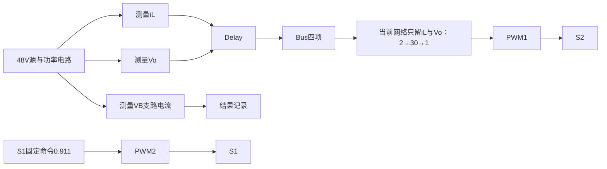

# 17：SIDO，Vs同时向VB端和Vo端送能

本章接在三个SISO模式之后。第05课已讲三段电流路径、门极时序及伏秒平衡；这里直接核对原SIDO工程、控制器和数据，避免重新讲同一电路。目标是逐步完成可追溯的原项目复现；目前已完成控制链及数据版本核对，动态门极和科研/硬件验收仍未完成。

## 1. 先把“两个受能端”与“两个闭环”分开

原工作副本：`02_仿真工程/03_SIDO/模型与算法/SIDO_VS48_VB72Vo200/SIDO_VS_VBVo.slx`。原参数源为48V，VB端在模型中是**72V理想电压源**，Vo目标200V。48V电源向VB与Vo两个端口送能，符合SIDO能量方向；但是原控制结构并没有同时独立闭环调节VB端电压与电池充电电流。

| 对象 | 原SLX中的实际连接 | 这说明什么 |
|---|---|---|
| S1（Mosfet） | `Constant1=0.911→PWM Generator (DC-DC)2` | S1占空比固定，非网络输出 |
| S2（Mosfet1） | `shu150（效果较好）→PWM Generator (DC-DC)1` | 只有S2由当前保存网络改变命令 |
| S3（Mosfet2） | 根层门极未连接 | 不能把未连接门极当作已设计的实物关断驱动 |
| 200V输出 | `Voltage Measurement→Delay1→Bus` | 进入网络反馈 |
| 电感电流 | `Current Measurement3→Delay→Bus` | 进入网络反馈 |
| 电池支路电流 | `Current Measurement7→Scope/测量记录` | 有充电方向证据，但**不进入当前活动网络** |

两个Delay都为一拍、2.5μs；三个PWM发生器设置100kHz。Bus有4项，活动模块内`removeconstantrows`固定`keep=[1 2]`，实际只保留**延迟iL、延迟Vo**。原网络隐藏层有30节点，每个节点2个输入，实际结构**2→30→1**；输入归一化范围约0～144A、0～214V。其余Bus项即使已连接也被活动网络删除；具体连线与权重版本见第4节。



用C理解**当前原模型控制方向**，函数名仅为教学示意：

```c
float d1 = 0.911f;                  // S1固定命令
float d2 = saved_nn_sido(il_prev, vo_prev); // S2网络命令
pwm_s1_request(d1);
pwm_s2_request(d2);
// battery_current在原模型用于观测充电方向，当前不进入活动网络。
```

第05课的理想三阶段条件是`0<d2<d1<1`，也讲过启动时曾出现`S1=0、S2=1`的额外门极状态。上面C片段只表明命令来源，不保证每个开关周期都满足这个顺序，更不是可上板固件。实际门极、有效占比和启动需用保存波形继续核对。

## 2. 已有仿真能证明到哪一步

案例结果目录已有`output.mat`、`voltage.csv`、`inductor.csv`、`battery.csv`、`gate1.csv`、`gate2.csv`、`windows.csv`、`cycles.png`和`run.txt`；统一入口`project_entry('sido')`打开测量教学副本，`project_entry('run_sido')`会重跑并覆盖本案例结果，当前读已有结果即可。

| 原基线窗口 | Vo平均 | iL平均 | 电池传感器原始方向 |
|---|---:|---:|---:|
| 16～19ms | 199.817V | 8.296A | −2.974A |
| 21～24ms | 199.420V | 15.697A | −5.259A |
| 26～29ms | 199.817V | 8.296A | −2.974A |

20ms、25ms发生负载支路事件。`Current Measurement7`的传感器方向使流向VB端的电流为负；据此可讲清该理想源端在模型中吸收能量，不能据此宣称真实电池的恒流恒压/SOC策略完成。启动电感采样峰值约147A；0～3ms内还采到857个`S1=0、S2=1`点，稳态三阶段图不能覆盖整个启动。更完整的三阶段波形和解释见第05课，不重复复制。

**本步自查：**能指出为什么SIDO有两个受能端，但当前只有一个网络调S2；能指出72V端的元件类型和电池电流测量线；能解释“Vo约200V”与“电池充电控制已实现”不是同一句结论。

## 3. 文件与版本的第一处警示

原SIDO目录中的`代码/EMPC1.m`已与VB→Vo目录的同名`代码/EMPC1.m`逐字节比较，SHA256相同。这份脚本仍写二维状态`[iL;Vo]`、单输出`C=[0 1]`、参考200V和一维占空比，**不能仅凭它放在SIDO文件夹，就说已建立了双输出/充电电流约束EMPC。** 原SLX保存的网络与历史标签是否由此脚本得到，要继续核对。当前网络是2→30→1；不能把脚本或MAT里任何同名网络未经比较就当活动版本。

## 4. 四项Bus、标签表和当前权重：数据究竟从哪来

按原SLX连线，Bus顺序为：①延迟一拍的`iL`；②延迟一拍的`Vo`；③`Divide3=Vref/Divide2`，其中`Divide2=延迟Vo/输出电流io`，所以数学上③为`Vref×io/延迟Vo`（`Vo=0`时有除零风险）；④`Vref=200V`。但当前活动网络的`removeconstantrows`只取①②。因此当前函数是`d2=f(iL[k−1],Vo[k−1])`；第三项不是实时参与控制的电池电流，电池支路的`Current Measurement7`更没有接入这条Bus。用C类比：结构体有四个字段，实际函数只读取前两个。

原文件中的数据链是**辨识样本→EMPC分区控制器`Bstep_controller10`→网格查询标签→网络训练→保存网络到SLX**。现有文件只能证实链条的若干段，不能自动认为每段都可由同一份脚本重建：

| 现存文件/变量 | 核对结果 | 当前可下的结论 |
|---|---|---|
| `model_train.mat/model_train` | 7333×5，前三列状态/命令，后两列下一拍状态；命令列恒为0.3275 | 有一份辨识容器；其与活动网络的精确关系未闭环 |
| `shu150.mat/shu150` | 234021×5；前两列约0～156A、0～240V，第三列固定1.3333，第四列200V，第五列约0～1 | 这是某次网格查询的有效标签，不等于当前网络权重 |
| `shu200.mat/shu200` | 115731×5；前两列约0～92A、0～200V；第三列1 | 另一工况标签 |
| `shu300.mat/shu300` | 113226×5；前两列约0～90A、0～200V；第三列0.6667 | 另一工况标签 |
| `changeR.mat/changeR`、`changeR1.mat/changeR1` | 分别231461×5、347191×5；其中嵌有合并标签和30节点`net` | 是历史合并/训练容器；两个文件内的`net`权重相同 |

上表来自`03_SIDO/脚本/inspect_sido_data.m`只读检查，逐变量尺寸和范围保存在`03_SIDO/结果/SIDO数据容器核对.json`。所谓第三列是标签表里**人为填入的工况常数**；不能把它解释成原SLX逐时采样得到的实时电流。第五列来自`Bstep_controller10`查询，是控制器标签，**不是实验测出的占空比**。

更关键的版本断点：当前保存的SLX活动模块确为**2→30→1**。已从其常量块抽出权重，`03_SIDO/脚本/extract_sido_network.py`和`结果/network_calculation.json`记录了静态计算；例如输入`iL=10A、Vo=200V`时算得`d2≈0.12524565`，改变Bus第3/4项而前两项不变，输出保持相同。这只验证抽出的网络算式，不代表该点闭环动态合格。`changeR.mat/net`虽然也是30节点，但其输入权重、偏置与SLX活动模块**不相同**（输入权重最大绝对差约104.26；见`结果/SIDO活动权重与MAT比较.json`）。因此不能把`changeR`或`changeR1`里的`net`冒充活动网络，也还不能指定活动权重由哪一张标签表训练得来。

当前`代码/train_sample.m`写661×461网格、第三列0.6666，名义上会查询304721个点；现存`shu300.mat`是113226行、第三列0.6667，说明保存物与这份脚本的参数/运行记录未精确对应。`代码/myguiyihua.m`写25个隐藏节点并用同一训练表后段作“测试”，与活动30节点不一致；它设`input_test=a1(290000:end,...)`，对现存113226行`shu300`甚至是空集。`代码/zhenghe.m`引用本目录并不存在的`shu20.mat`/`shu40.mat`。这些原脚本留作线索，不能直接运行后宣称原结果可重建。

**本步自查：**指着Bus说出四项及活动两项；说出标签第五列是EMPC查询值、不是实测值；说出“30节点”相同为什么仍不能认定MAT与SLX是同一个网络。

## 5. 实际门极、变载与启动：三阶段成立到什么范围

此处直接读取上次30ms仿真的`gate1.csv`、`gate2.csv`、`inductor_fast.csv`、`battery.csv`等结果，未重跑或修改电路。门极、电感快速波形、电池传感器以0.1μs取样；输出电压、网络命令以2.5μs取样。分析脚本`03_SIDO/脚本/analyze_sido_gates.py`，完整数字在`03_SIDO/结果/SIDO门极与变载核对.json`。

在18ms抽取一个10μs开关周期，100个采样点依次为**11共59点 → 10共33点 → 00共8点**（位序S1、S2）。对应阶段内部的电感电流拟合斜率约`+0.414、−0.241、−1.831 A/μs`，与第05课理想估计`+0.436、−0.218、−1.818 A/μs`符号和量级一致；电池传感器在10阶段平均约`−9.06A`，11/00阶段近零。这比只看波形截图更明确地支持“10阶段向72V端送能”。斜率差异和门极边界采样受非理想器件/离散化等影响，不能仅凭本次拟合锁定具体损耗来源。

| 取样窗口 | 11占比 | 10占比 | 00占比 | 异常01 | S1实际高电平占比 | S2实际高电平占比 |
|---|---:|---:|---:|---:|---:|---:|
| 16～19ms | 58.82% | 33.00% | 8.18% | 0 | 91.82% | 58.82% |
| 21～24ms | 60.00% | 32.00% | 8.00% | 0 | 92.00% | 60.00% |
| 26～29ms | 59.00% | 33.00% | 8.00% | 0 | 92.00% | 59.00% |
| 启动0～3ms | 81.61% | 10.27% | 5.26% | 2.86% | 91.88% | 84.47% |

表中是**采样门极的高电平比例**，不是控制器给PWM模块的命令。三个稳态窗口的网络命令均值分别约`0.55877、0.54995、0.55877`，与S2门极高电平比例`0.5882、0.6000、0.5900`有差异；S1给定0.911，测到约0.918～0.920。第05课按理想模型算出的`d2≈0.551`只能作数量级解释，不可把它、网络命令和实际门极占比写成相等；PWM内部更新时间/边沿定义及器件非理想仍需单独核实。尤其不能直接用测到的高电平比例代入理想伏秒式，再声称必须精确得200V。

20ms负载事件后，21～24ms平均电感电流由8.30A增至15.70A，电池传感器均值由−2.97A变为−5.26A，输出电压仍约199.42V。25ms事件后，26～29ms恢复约8.30A、−2.97A、199.82V。事件后首1ms的输出范围分别是`199.399～199.829V`和`199.419～199.829V`；这些是**已保存模型的采样结果**，不是实物动态指标，也不能只用三个平均数证明全工况稳定。

启动例外必须单列：`S1=0、S2=1`首次出现在9.2μs，末次在2.9993ms，共857个0.1μs采样点；3～16ms及上述三个稳态窗口均未采到。电感电流最大约**147.04A**，发生在2.6375ms；电池传感器还在启动约2.6792ms出现**+146.86A**的瞬时正向峰值。故“稳态三段正确”不等于“启动受控”，也不能据稳态负值断言全程都是给电池充电。当前模型没有可直接上板的启动限流/充电保护证据。

用C逻辑看门极表：`state=(S1<<1)|S2`，正常稳态允许`3(11)、2(10)、0(00)`；启动采到`1(01)`。这只是状态分类，硬件实现还要明确死区、故障响应和电流限制。

**本步自查：**能从18ms周期指出三个状态及电流斜率/电池电流对应关系；能区分网络命令和实际门极比例；能说出为什么启动01状态与147A峰值会阻止直接上板。下一步核对该模式的理论/仿真证据缺口和论文描述边界，再进入DISO。

## 6. 本模式阶段结论与未通过项

SIDO已达到**原保存模型的第一遍复现和可讲解**：能用05的三段电路解释门极与电流斜率；能沿`iL/Vo→延迟→活动网络→S2 PWM`和`S1固定PWM`找到控制链；能从原标签表与保存CSV追溯现有数据；30ms模型结果和20/25ms变载已用数字核对。汇报时可以说“原理想源SIDO模型在三个稳态窗口将Vo维持在约199.4～199.8V，72V端传感器均值显示吸收电流”，同时说明这不是实物电池恒流/恒压控制。

距**完整、可审查的复现**仍有以下具体缺口，保留在SIDO章，不能靠进入DISO把它们标成通过：

| 维度 | 还要完成的验证 | 当前不能宣称 |
|---|---|---|
| 理论和参数 | 从各段KVL/KCL继续推导平均电流、器件电压/电流应力和纹波，核对L=110μH、C=220μF、100kHz及负载设计依据；解释理想占空比与仿真门极差异 | 所有公式、器件选型和损耗效率已闭环 |
| 控制与数据 | 核实此模式辨识A/B、目标函数/约束/区域和`Bstep`导出版本；找到活动30节点网络的训练输入、随机记录和保存步骤，建立从标签到SLX权重的重建证据 | `changeR/net`就是活动网络、四输入都参与控制、真正双输出EMPC已经实现 |
| 仿真和安全 | 检查启动01状态、147A电感峰值、72V端正向峰值；补全限流/过压和域外网络输出处理，再与原基线对照；逐图核对论文SIDO图4-13/14与模型版本 | 全过程满足占空比约束或可直接用该门极策略上板 |
| 科研比较 | 用同功率级和扰动设置核对原PI/PID对照，记录误差、峰值、恢复与计算代价；需要时补Simplis和非理想器件仿真 | 该网络优于基线、具有泛化或硬件可靠性 |

这些是**SIDO待验收任务**，不是要求此刻重训一个新网络替换原模型。任务继续留在本章及论文覆盖清单中，后续针对性核对，PPT前不能改写成已通过。下一步按固定顺序进入DISO，先确认原模型与论文模式是否相符。
