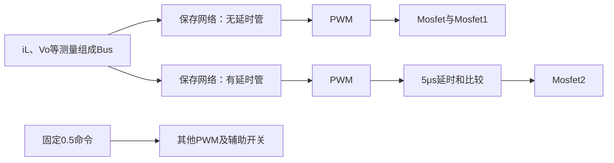

# 18：DISO，两个输入共同向Vo送能

本章接第17章SIDO。第06课已讲四段电流路径、理想伏秒公式和早期运行波形；这里不重画同一电路，直接核对**原工程实际接线、两份模型的差异及数据是否支持文件名**。目标是把DISO原基线讲清并逐步完成可追溯复现；目前已完成双模型控制、活动网络/数据、门极、电压测量极性和固定命令案例延时诊断，尚未验收全部算法来源与动态安全性。

## 1. 先认两个文件，不能混成一套控制器

工作副本在`02_仿真工程/04_DISO/模型与算法/DISO_VS48VB72_Vo200`。两份SLX均使用48V输入和72V**理想电压源**表示VB端，100kHz PWM，但不是“只改功率分配”的同一模型。`脚本/inspect_diso_models.m`只读取SLX，门极来源和关键参数保存到`结果/DISO双模型接线参数核对.json`；历史测量来自`脚本/run_diso.m`生成的两个结果目录，本次没有重跑或改原电路。

| 项目 | `DISO_VS270W_VB30W.slx` | `DISO_VS30W_VB270W.slx` |
|---|---|---|
| 仿真时长 | 80ms | 100ms |
| 主控制 | 同一测量Bus接入`shu150-无延时管`、`shu150-有延时管`两路保存网络；分别通往PWM | `Constant=0.44`、`Constant2=0.32`等固定命令通往PWM，没有活动网络反馈 |
| `Mosfet`、`Mosfet1` | 同一个PWM输出驱动 | 同一个PWM输出驱动 |
| `Mosfet2` | 第二路网络→PWM→5μs Transport Delay→`>=1`比较器 | 固定0.32→PWM→25拍`Delay` |
| `Mosfet3` | 固定0.5→另一PWM | 固定0.5→PWM→25拍`Delay1` |
| `Mosfet4`、`Mosfet5` | 固定0.5→PWM→5μs Transport Delay→`>=1`比较器，二者同一门极 | `Mosfet4`由固定0.5的另一PWM驱动；`Mosfet5`与`Mosfet2`同一延时门极 |
| 负载事件 | 50ms、60ms的Step驱动额外`Mosfet6～9`支路 | 不采用同一组50/60ms Step负载事件 |

第二模型的`DelayLength=25`是**25个采样拍**；已由保存门极对齐验证相当于2.5μs，不能写成5μs。第一模型则明确使用`Transport Delay=5e−6s`。第一模型中的网络名称与原`shu150-Vs无延时管关键参数.txt`、`shu150-VB有延时管关键参数.txt`呼应，但“名字对应”还不等于已经核准权重、训练表和两路端口实际分功率；网络与数据核对见第3节。

这是第一模型的**信号控制链简图**，不是功率回路图。第06课三开关四阶段是理论示意；两份原SLX还有辅助开关，所以不能拿三开关表直接当全部实际门极状态。用C打比方：两个文件虽然都叫`DISO`，但一个执行`d=nn(state)`，另一个执行`d=constant`，相同函数名不能证明内部算法相同。

## 2. 文件名功率要用测量值核对

已保存`结果/DISO_VS270W_VB30W/windows.csv`显示：

| 窗口 | 平均Vo | 48V端平均供出功率 | 72V端平均供出功率 |
|---|---:|---:|---:|
| 45～49ms | 200.206V | 53.267W | 98.957W |
| 55～59ms | 200.005V | 99.609W | 189.244W |
| 65～69ms | 200.206V | 53.267W | 98.957W |

两路测量平均功率均为正，支持“两个输入都在供能”；但**测得的端口功率并非270W与30W**，文件名不能当成端口测量结论。50/60ms负载事件改变工况，因此三个窗口不能混算同一额定功率。表中功率为固定源电压乘各自传感器的窗口平均电流；尚未把所有负载、储能变化和损耗逐一对账，更不是实测效率。该例启动`Vo`峰约230.66V、`iL`峰约162.72A，也不能据稳态200V认为全程受约束。

另一份`结果/DISO_VS30W_VB270W/windows.csv`中45～49ms平均输出**−116.935V**，65～69ms仍约**−116.149V**，没有得到+200V。原固定命令模型按原参数运行后**未达到目标**；电压测量极性、实际功率回路和门极组合的后续定位见第5节，不能擅自改符号或占空比来凑结果，更不能把文件名`30W/270W`当成验证值。

**本步自查：**能指出第一模型有两路保存网络、第二模型是固定命令；能沿门极线说出`Mosfet2`的两种不同驱动；能说出为什么“约200V且两路功率为正”仍不能证明270W/30W分配，以及为什么第二例不能标为复现成功。

## 3. 两路活动网络究竟读取什么、标签从哪来

第一模型的Bus有4项，按原SLX连线依次为：①`Current Measurement3→Delay2`的电感电流；②`Voltage Measurement→Delay3`的输出电压；③`Vref/(延迟Vo/输出电流io)`，即代数式`Vref×io/延迟Vo`；④`Vref=200V`。两个Delay均为一拍、标称采样时间2.5μs。**两个活动网络虽然都接4项Bus，却都通过`removeconstantrows keep=[1 2]`只读取前两项**；第3/4项被删除。电源支路电流与72V端支路电流分别记录到Scope，没有直接进入这两个网络。这解释了为什么不能仅凭两路网络的存在，就宣称它在闭环控制两端功率分配。

从保存的`DISO_VS270W_VB30W.slx`直接抽取常量块，两个网络的有效结构均为**2→15→1**、隐藏层和输出层均用`tansig`，输入归一化范围同为`iL=0～156A、Vo=0～240V`。但两套权重不同：同取`iL=10A、Vo=200V`，静态算式分别输出约`0.233676`（无延时管）和`0.240270`（有延时管）。这是`脚本/extract_diso_networks.py`对**已保存网络算式**的计算，参数与样例在`结果/DISO双网络结构核对.json`；尚不是独立Simulink前向对照或闭环性能结论。两个输出各自经不同PWM/延时链路，不能把这两个数直接当两端平均功率比例。

| 数据/脚本 | 本次核对结果 | 证据边界 |
|---|---|---|
| `model_train.mat/model_train` | 7333×5；前三列为`iL[k],Vo[k],d=0.403`，后两列为下一拍状态 | 有辨识样本容器；拟合A/B与两个活动网络的完整生成关系未闭环 |
| DISO目录`shu150.mat/shu150` | 234021×5，前两列覆盖0～156A、0～240V，第3列恒1.3333、第4列200V，第5列约0～1 | 是`Bstep_controller10`网格查询标签，不是实物测量；其归一化极值与**无延时管**网络对应，但尚不能凭范围证明训练权重来源 |
| SIDO目录同名`shu150.mat/shu150` | 与DISO表同为234021行，前4列逐行相同；第五列有25710行不同，最大差约0.19769 | 两张表不是同一份标签；**有延时管**网络的输出归一化极值与SIDO表吻合，仅是来源线索，不等于训练记录已找到 |
| `代码/train_sample.m` | 网格写601×391点、步长0.4；第3列人为填1.3333，第5列查询`Bstep_controller10`；之后滤掉NaN | 名义网格234991点，保存有效标签234021行；生成步骤有线索，未重跑历史EMPC导出 |
| `代码/myguiyihua.m` | 设15隐藏节点，从`shu150`全部行训练，再把同批数据后段`150000:end`当测试 | 节点数与活动网络相符，但手工“测试”不独立，也没有随机种子/网络版本证明对应当前任一路SLX权重 |

MAT只按指定变量读取，检查脚本`脚本/inspect_diso_data.m`与`结果/DISO数据容器核对.json`、`DISO与SIDO同名标签对比.json`保留逐列范围和跨模式比较。这里最容易讲错的是**表第3列是离线生成时填的工况常数，在线Bus第3项是一个派生量，而当前网络两者都不读取**。C类比：两个函数`dv=f(il_prev,vo_prev)`、`db=f(il_prev,vo_prev)`都收到同一结构体，但编译后的计算只用前两个字段；它们的权重、PWM路径不同，不能互换。

**本步自查：**能画出`iL/Vo→一拍延迟→同一Bus→两路15节点网络→不同PWM`；能说出两张`shu150`前4列一样而第五列不完全一样；能解释为什么“归一化范围吻合”只是网络来源线索。

## 4. 实际门极与负电压：符号问题只解决了一半

直接读取上次仿真的`gate1～gate6.csv`和两路输入电流；六位状态按`Mosfet、Mosfet1、Mosfet2、Mosfet3、Mosfet4、Mosfet5`排列，0.1μs一个采样点。`脚本/analyze_diso_gates.py`生成`结果/DISO双案例门极核对.json`，未修改两份原SLX。

在网络案例46ms的一个10μs周期，主要状态依次是`110100`约3.8μs→`000100`约1.2μs→短暂过渡`001111`约0.1μs→`001011`约3.5μs→`000011`约1.4μs。`110100`段48V端电流平均约2.94A，72V端近零；`001011`段72V端约2.71A，48V端近零。这提供了**两输入在一个周期内分时供能**的直接波形证据，但六开关组合仍需结合辅助开关功率路径逐项核对，不能把它简写成第06课三开关的a/b/c/d位图。45～49ms整窗中`Mosfet`与`Mosfet1`门极高电平比例均38%，`Mosfet2`为36%。

固定命令案例46ms的一个周期则出现`110010→111111→001111→001101→000100→000000`；45～49ms整窗里**`111111`占20%采样点**，而网络案例同窗主要是上段的分时组合。`111111`中48V、72V端都测到正电流，但只凭门极位图不能断言具体器件短路；要继续核对功率通路、体二极管和各开关实际电压/电流。两案例不能因同叫DISO就套用相同的四段PWM时间。

负号的来源已通过原SLX物理端子追到：两份模型的输出电容`Series RLC Branch2`左端接地、右端为输出高端。**网络案例**的`Voltage Measurement`端子2接电容右端，端子1经输出电流测量支路接返回端；**固定命令案例**的端子2直接接地/电容左端，端子1经输出电流测量支路接电容右端，方向相反。接线明细由`脚本/audit_diso_voltage_wiring.py`写入`结果/DISO输出电压测量接线核对.json`。这解释保存波形为什么全程显示负电压；按同一测量方向换算，电容两端**幅值约117V**，仍不是目标200V，所以此例不仅是图上符号画反。

两模型负载也不同：网络案例有若干300Ω支路；固定命令案例的两个电阻为**148.148Ω和1333Ω**，若各自全程接在200V上，理论功率分别约270W和30W，这可解释文件命名的一种可能含义，**不等于已经测到端口分功率或实际负载功率**。尤其旧`run_diso.m`对两个模型都硬算`mean(Vo²)/300`并命名`one_300ohm_W`；对固定命令案例，该列只是数学量，**不是其中任一真实电阻的功率**，不可拿去做效率或论文表格。负载开关接通时段与完整功率守恒还要另核。

**本步自查：**能说出网络案例分时供能的一组门极/电流证据；能指出固定命令案例有六门极同时高的不同状态；能在SLX里找到电压传感器相对输出电容的反向接法；能解释“−117V改号成+117V”仍未达到200V。

## 5. 固定命令案例为什么停在约117V：功率路径和延时对照

先核对电路而非猜参数。该模型输出电容高端经`Current Measurement1`分成两路：一路经`Current Measurement5→Mosfet3→148.148Ω`到地；另一路经`Current Measurement6→Mosfet4→1333Ω`到地。接线节点在`结果/DISO输出电压测量接线核对.json`，负载门极分别见`gate4.csv`、`gate5.csv`。`脚本/diagnose_diso_fixed.m`只在**内存中的原模型**增加三个测量端，不保存SLX，得出45～49ms：电容电压约116.94V，148.148Ω支路**46.18W**、1333Ω支路**5.40W**，合计**51.58W**；同窗口两输入测得约`7.19+51.42=58.62W`。这些是运行中的真实支路电流乘电压，不再使用错误的`Vo²/300`。输入与负载差约7.04W不能未经完整器件/储能对账就直接写成“效率损耗”。诊断细数在`结果/DISO_VS30W_VB270W/DISO固定命令支路功率诊断.json`。

再核对时序。原`Delay`和`Delay1`都设25拍，但保存门极在45～49ms表明：`gate4`相对同频同命令的`gate5`平移**25个0.1μs采样点后逐点一致**，即这组延时实际约**2.5μs**；证据在`结果/DISO双案例门极核对.json`。`Delay`驱动`Mosfet2/Mosfet5`，`Delay1`驱动`Mosfet3`。为分清责任，`脚本/compare_diso_delay.m`仅在内存中改变这两处拍数，其余固定命令、元件和接线均不变，每种设置从头运行100ms；原SLX和原基线CSV均未覆盖。

| 临时设置（Delay / Delay1） | 45～49ms电容电压均值 | 65～69ms电容电压均值 | 判断 |
|---|---:|---:|---|
| 原模型 25 / 25 | 116.94V | 116.15V | 未达200V |
| 只改`Delay`：50 / 25 | **198.96V** | **199.26V** | 两个窗口接近目标 |
| 只改`Delay1`：25 / 50 | 116.65V | 115.71V | 仍未达目标 |
| 两处都改：50 / 50 | 198.92V | 199.22V | 与只改`Delay`接近 |

这组**控制变量对照**把原固定命令案例的主要稳态电压差定位到`Delay→Mosfet2/Mosfet5`门极链：原25拍约2.5μs；改为50拍约5μs时，原模型其余参数不变，两个窗口都到约199V。只改`Delay1`无此效果。第一网络案例恰有5μs Transport Delay，但这仍不能反推原作者必然打算把第二模型设成50拍。改进版本目前只是**可重跑的诊断脚本和结果**（`结果/DISO_VS30W_VB270W/DISO延时单因素诊断.json`），不是替换原文件的“正确版”，也未验证启动过流、全时域、所有负载、器件应力和功率分配。电压测量端子的极性仍反向，报告表采用已说明的电容电压正向值。

**本步自查：**能沿电容到两个电阻画出实际负载回路；能用25点×0.1μs说明原延时是2.5μs；能从四行对照表指出真正敏感的是哪条门极链；能区分“原模型失败”和“临时修改在两个窗口达到约199V”。下一步整理DISO第一遍通过项/未验收项，然后按固定主线进入模式切换。

## 6. DISO第一遍结论，哪些仍不能带进PPT当定论

**已能讲清：**第06课的四段理想电路与总伏秒关系；两份原SLX的控制结构不同；网络案例的双输入分时供能、两路活动2→15→1网络及数据版本；两个案例的门极和端口波形；固定命令案例的测量反接、真实负载功率、2.5μs延时与临时改成5μs后的稳态改善。现有原始结果、诊断脚本和JSON均可追溯。

**完整复现仍未通过：**

| 维度 | 继续验证的内容 | 当前不能宣称 |
|---|---|---|
| 理论/硬件参数 | 四段平均电流、应力、纹波、二极管/辅助开关路径与L/C/器件选型；非理想损耗和效率对账 | 三开关理想式直接等于六开关实际模型，或已有可上板额定参数 |
| 算法/数据 | 两路活动网络精确训练来源，辨识A/B与两路控制器的对应；训练集独立评估和网络前向对照 | 同名`shu150`可混用、已重训出当前权重、双输入功率分配闭环已验证 |
| 仿真/异常 | 网络案例启动230.66V/162.72A的约束问题；固定命令案例延时50拍版本的启动、完整波形、支路应力与功率对账；原论文图4-15/16逐图版本 | 原两个模型都在全程达到200V和目标功率，或临时修改已成为合格控制器 |
| 比较/论文 | 同一功率级与负载下的PI/PID、EMPC及NN公平对照，响应、峰值、计算量和鲁棒性 | 当前网络优于基线或满足顶刊性能主张 |

本章暂按“**DISO原基线第一遍已分析，第二文件失败原因有受控证据**”记录，不把临时对照写成原作者结果。相关缺口继续留在本章和论文覆盖清单。下一模式进入**模式切换**，先逐一核对论文要求的切换方向和原模型，避免再用反方向案例代替。
