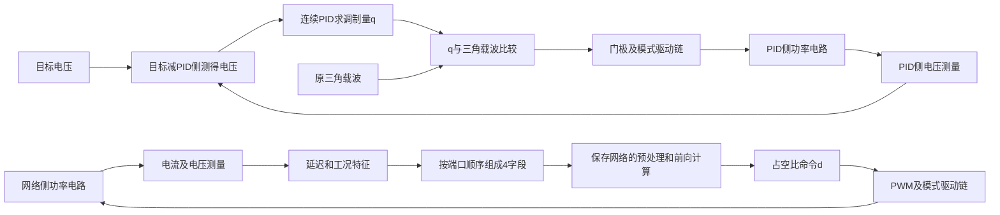

# 20 原PID对照：先确认比较对象，再谈优劣

承接第19章切换复现，本章核对毕业论文4.7节图4-20～29使用的五种单模式对比工程。原资料目录名叫`PI闭环`，但不能据此称它是PI：`99_来源与检查/audit_pi_controllers.m`只读遍历原14个SLX，结果`原PI目录控制器参数核对.csv`显示五个单模式及其`_duibi`版的顶层控制器均配置为**连续时间PID，D项非零**。例如Vs→Vo原模型P=1、I=600、D=0.0001，`_duibi`版P=0.6、I=800、D=0.0001；不可以混用参数再声称复现论文同一比较。

## 1. 原工程与测量归属

原`PI闭环`目录14个文件已完整复制到`02_仿真工程/06_PID对照/模型与算法`，逐文件SHA-256一致，原资料保持只读。五个`*_duibi.slx`已由`脚本/run_original_duibi.m`按原StopTime、原Step、原PID/网络和原电路直接运行；仅在内存给所有原电压传感器接记录端，结果用各自模型名前缀保存，未保存修改后的SLX。部分原模型有未接测量端和启动除零警告，保留在各自`_run.txt`。

`脚本/audit_duibi_wiring.py`沿原SLX的顶层信号线及Goto/From核对传感器反馈，证据为`结果/PID对照测量与控制连线核对.json`。必须先分清两套电路的输出测量：

| 原`_duibi`模型 | PID侧输出传感器 | 网络侧输出传感器 | 两次原Step时刻 |
|---|---|---|---|
| Vs→Vo | `Voltage Measurement` | `Voltage Measurement2` | 40/60ms |
| VB→Vo | `Voltage Measurement` | `Voltage Measurement2` | 80/100ms |
| Vs→VB | `Voltage Measurement1` | `Voltage Measurement3` | 30/40ms |
| SIDO | `Voltage Measurement` | `Voltage Measurement1` | 50/70ms |
| DISO | `Voltage Measurement` | `Voltage Measurement1` | 50/60ms |

PID侧传感器已由反馈通往`PID Controller`直接确认；Vs→VB的PID侧是`Voltage Measurement1`，不能照搬其他四案的编号。网络侧多数传感器可追至`shu`网络；Vs→VB另以72V受电端测量位置和两套电路布局识别，仍要在公平对照前逐线确认其控制输入和负载完全对应。其余约46V或−24V的测量曲线不是200V/72V输出比较对象。

公平性先做一个**有限但可重复的参数检查**：`脚本/audit_duibi_components.py`按两套电路在SLX画布的上下位置分组，比较原DC源电压、各R/L/C元件实际启用的参数和Step时间/前后值。五个`_duibi`模型的这三类参数多重集在上下两侧**全部一致**，明细在`结果/PID双电路元件参数初核.json`；直接连接到MOSFET门极的已见PWM发生器频率均为100kHz。这加强了同工况对照的可信度，但位置分组和元件值相同不等于完整电气网表、寄生、传感器方向、控制延迟和初始状态也相同，仍需逐案检查。

## 2. 同一定义复算原保存模型

论文4.7节称网络拟合EMPC动态效果较好，但图上没有统一的数值评价表。本章用`脚本/analyze_duibi_metrics.py`从五个原`_duibi`运行CSV计算：每次原Step前1ms到前0.1ms为切换前均值，Step后首1ms取相对该均值的**最大绝对电压变化**；Step后2～5ms算相对目标的稳态误差。完整逐案逐事件数值在`结果/原PID与网络比较统一指标.csv/json`。这个定义**不是**论文的恢复时间，也不是硬件性能。

| 模式 | PID侧两次首1ms峰值变化 | 网络侧两次首1ms峰值变化 | 需要保留的例外 |
|---|---:|---:|---|
| Vs→Vo | 1.960/1.980V | 0.198/0.192V | 首次事件后稳态误差PID约0.206V、网络约0.272V |
| VB→Vo | 2.315/1.024V | 0.168/0.162V | 原`_duibi`与非对照版StopTime不同，版本勿混用 |
| Vs→VB | 1.648/1.571V | 1.279/0.150V | 首次事件网络峰值并非“几乎为零” |
| SIDO | 1.577/1.587V | 0.419/0.409V | 首次事件后稳态误差PID约0.567V、网络约0.580V |
| DISO | 1.138/1.164V | 0.214/0.206V | 第二次事件后稳态误差PID约0.139V、网络约0.206V |

在这五个原保存比较模型、相同的本章**峰值变化定义**下，网络侧十次事件均小于PID侧。这是“原模型的有限对照结果”，不是“网络在所有指标/工况/硬件上都优于PID”。特别是连续时间PID与离散网络的实时计算约束不同；已初核的源/RLC/Step相同之外，两套电气连接、初始状态、采样/测量和控制更新口径还需逐项确认，不能直接作为SCI公平比较。

**本步自查：**为什么目录叫PI而正文应写PID？为什么Vs→VB不能取`Voltage Measurement`当72V输出？能说出一个网络侧稳态误差不优于PID的原案例吗？为何这十次事件不能证明硬件实时优势？

## 3. 到硬件/论文前还要补的比较证据

1. 对五个`_duibi`工程逐案核对双电路元件、负载Step幅度、采样延迟和参考值是否一致；若不一致，先列差异再决定能否作为公平基线。
2. 固定统一指标和工况；计算启动峰值、两次变载峰值、稳态误差和恢复时间，保留失败工况。恢复时间必须预先定义容差带与连续保持时间。
3. 若转入MCU，连续时间PID须离散化并重新核准参数和计算预算，网络C推理也须做逐点前向验证与最坏时间测量；两者在同一硬件/功率级上再比较。

本章完成了**原五份比较模型的第一遍运行和控制器身份核对**，公平性与论文逐图验收仍未完成。先做老师阶段汇报时可以展示这张有定义、有例外的表，同时明示图4-19源模型冲突与硬件未实现。

## 4. 把原对照模型的两条闭环真正串起来

2026-10-08继续主线：本步只读五个原`_duibi.slx`的实际信号线、端口和参数，并用MATLAB加载工作副本查询库块默认值。**没有重新仿真、训练或保存模型修改。** 结果为`06_PID对照/结果/五模式PID与网络闭环信号链.json`及`原比较器与PID限幅设置.json`；五个文件读取前后SHA-256一致。

先更正“原工程有很多问题”的说法：**已经测到的异常、已经确认的实现差异、尚未检查的事项是三类事。** DISO固定命令另例约117 V是具体异常；历史训练版本差异是生成链的对应问题；未完成公平性检查不代表原比较一定无效。主线仍是逐模式把闭环解释清楚，不因这些事项把正常案例全部推倒重做。

### 4.1 同一个对照模型包含两套独立闭环

这里的“对照”不是PID先算一次，再交给网络接着算。它是在同一个仿真中放两套功率电路：一套由PID控制，另一套由保存的网络控制，再看各自输出。



图概括顶层信号方向；DISO多路调制、延时和额外开关需要按其实际分支展开，不能把图当五模式统一门极真值表。

本步沿原信号线确认的对应如下，名称只用于定位该文件，不能跨模型照搬MOSFET编号：

| 模式 | PID侧反馈电压 | 网络侧反馈电压 | 网络前两字段延迟 | 网络输出接到的PWM |
|---|---|---|---|---|
| Vs→Vo | Voltage Measurement | Voltage Measurement2 | Delay2、Delay3 | PWM Generator (DC-DC)4 |
| VB→Vo | Voltage Measurement | Voltage Measurement2 | Delay4、Delay3 | PWM Generator (DC-DC)6 |
| Vs→VB | Voltage Measurement1 | Voltage Measurement3 | Delay3、Delay1 | PWM Generator (DC-DC)4 |
| SIDO | Voltage Measurement | Voltage Measurement1 | Delay2、Delay3 | PWM Generator (DC-DC)3 |
| DISO | Voltage Measurement（到两套PID） | Voltage Measurement1（到两套网络） | Delay1、Delay4 | 两网络分别接PWM Generator (DC-DC)及(DC-DC)5 |

五份原对照的网络Bus第1/2字段分别由电流、电压测量经过一拍Delay送入，第3字段来自`Divide3`工况特征，第4字段为参考电压（三种200 V输出及SIDO/DISO为200，Vs→VB为72）。**接入4个字段不等于网络使用4个字段**，真正保留哪些输入由对应保存网络的预处理决定。前面单模式章已有有效输入检查，本步没有宣称对照版和单模式版权重逐字相同。

### 4.2 PID输出不是网络输出的同一种数值

网络侧的输出`d`送入PWM发生器，含义是占空比命令。原PID侧多数路径则是：

`测量电压 → Goto/From → Sum → PID Controller → Relational Operator → Goto/From → MOSFET门极`

MATLAB已确认比较符号为`>=`；PID输出限幅开启，上下限为`+1000/-1000`。所以这里的PID输出`q`是**与载波同尺度的调制量**，并非直接输出0～1占空比。两边最后都产生门极，但中间数值含义不同。

设三角载波在一周期内从`c_min`线性变化到`c_max`再返回，并暂时把PID调制量`q`看作周期内常数。由于门极在`q >= carrier`时为1，高电平时间比例为：


$$
d_{\mathrm{PID}}\approx
\operatorname{clip}\left(\frac{q-c_{\min}}{c_{\max}-c_{\min}},0,1\right).
$$


这是解释调制尺度的近似关系；实际`q(t)`在周期内变化或后面还有分时/延时链时，门极占比必须从最终波形测量。

例如原Vs→Vo对照载波的时间点是`[0, 5 μs, 10 μs]`，幅值为`[-260.4, 550, -260.4]`。假设某一周期`q=0`不变，上式给出的高电平比例约`260.4/810.4=0.321`，**并不是零占空比**。这只是原载波参数的计算示例，不是新仿真实测，也不表示实际稳态PID输出为0。实际积分状态会改变`q`。

用你熟悉的C逻辑看，两边的信号语义相当于：

```c
/* 说明信号含义的伪代码，不是已实现的离散PID固件 */
double error = reference - voltage_pid;
double q = original_pid(error);   // 原模型是连续PID块
bool gate_pid = (q >= carrier(t));

double raw[4] = {current_previous, voltage_previous, feature_z, reference};
double duty = saved_nn(raw);      // 含原输入筛选、缩放、权重和输出还原
bool gate_nn = original_pwm(duty, t);
```

它们各自驱动一套电路。`gate_pid/gate_nn`在示例中表达一个调制通道；五模式的常开、常关、同步和分时开关仍分别设置。

### 4.3 三个时间概念必须分开

1. **状态延迟间隔：** 五个对照网络反馈中已见一拍Delay参数为`2.5e-6 s`，它决定保存/延迟状态的间隔。
2. **载波周期：** 多数网络侧PWM参数`Fsw=100000`，对应10 μs；原PWM块`Ts=0`。不能把块的`Ts=0`说成“MCU零延迟”，也不能把一拍Delay直接说成网络完整执行耗时。
3. **实际门极调度：** SISO主要看最终PWM边沿；SIDO/DISO还要看固定门极、分时和驱动延时。特别是原DISO对照PID侧三角载波时间点为`[0, 2.5 μs, 5 μs]`，另一支路还串接`Fsw=200000`的PWM与Transport Delay；网络侧保存PWM主要为100 kHz。**这个参数与连接差别已确认，但最终两侧器件的有效周期仍要看各自门极，不能直接宣布频率比较失败。**

因此，原第1节“已见直接连接模块均100 kHz”仅是局部观察，不代表DISO全驱动链完全一致。此前参数初核没有覆盖此链路，本步已经补出这项具体差别。

PID侧的电压反馈到PID输入没有经过网络侧那一拍状态Delay；网络侧电压反馈经过Delay进入Bus。原连续PID、离散状态反馈和不同调制尺度可以解释两边实现，但公平比较还需要对最终采样/调制条件作统一说明。

### 4.4 怎么判断你把闭环理解了

能够对当前模式依次说明以下六件事，就达到了本轮闭环学习的目标：

1. 电压、电流到底从哪个支路测，正负方向是什么；哪个电压是本模式受控量。
2. 进入控制器的是当前量还是延迟量；原Bus字段哪些真正参与网络计算。
3. 控制器在线做什么：PID按误差计算，网络按固定权重前向计算；MPC/EMPC标签生成属于前面的离线过程，原网络闭环不每拍重新求解MPC。
4. 输出是占空比还是载波调制量；如何变成最终门极，各个开关如何配合。
5. 门极改变电感储能/放能阶段后，电流、电容电压和测量反馈怎样变化。
6. 变载或切换时，哪张电压/电流/门极波形、哪个定义清楚的指标证明它的表现。

**本步完成：** 五份对照顶层传感器→控制器→调制→门极路径及比较器/限幅设置已核对；Vs→VB网络块原名为`变载4.0（最好）`，旧脚本只搜`shu`漏报它，已用Bus→子系统→PWM连接补识别。尚未完成电气网表全部等价、编译后的更新时序和DISO最终门极周期核定，不能标“全部公平性已通过”。下一步在既有模型内按信号链核定最终门极与功率路径，不回到原理开头重讲。

## 5. 用实际门极和电流，把闭环最后一段接上

本轮针对Vs→Vo和DISO的原`_duibi`工作副本补测，**沿用原控制器、元件、求解器及初始设置**，仅在内存中分支接入继承采样的To Workspace，分别运行到39 ms、49 ms（原首次变载前）。不保存SLX；补测后两文件SHA-256与上一轮一致。这不是新辨识、重训或实物实验，原完整变载结果仍保留。

脚本为`06_PID对照/脚本/capture_final_gate_cycles.m`和`analyze_final_gate_cycles.py`。`结果/最终门极补测清单.json`逐项对应器件、驱动源及CSV；`最终门极周期与闭环补测.json`保存统计。Vs→Vo窗口38.9～39.0 ms，DISO窗口48.9～49.0 ms，均为100 μs；图展示各窗口起始的30 μs局部波形。门极高占比按持续时间积分，周期取相邻上升沿间隔的中位数，**不是按高电平采样点数或模块名称猜测**。继承原可变步长采样，边沿及统计是该仿真的数值结果，未做步长收敛验证。

### 5.1 Vs→Vo：控制命令不同，最终都通过储能/放能稳压


图中蓝色为PID电路，红色为网络电路；第二行网络门极仅为方便阅读上移1.3，实际仍是0/1。第一行PID曲线是按第4节公式换算的等效占空比，并非把PID原输出改成0～1。

| 同一100 μs窗口的统计量 | PID侧 | NN侧 |
|---|---:|---:|
| 控制器输出时间均值 | 调制量q≈399.130 | 占空比命令d≈0.83379 |
| 最终主门极高电平时间占比 | 0.81383 | 0.81340 |
| 最终主门极周期中位数 | 10.000 μs | 10.000 μs |
| 输出电压时间均值 | 200.002 V | 199.901 V |
| 门极为1时电感电流斜率中位数 | +0.41931 A/μs | +0.41922 A/μs |
| 门极为0时电感电流斜率中位数 | −1.83284 A/μs | −1.83192 A/μs |

PID主门极为`Mosfet/Mosfet1`，网络侧为`Mosfet5/Mosfet6`，各自两只同驱动。两侧另有常关、常开的模式设置器件，它们不应被统计为100 kHz开关。电感电流分别由`Current Measurement3/9`测量；原电气连线确认它们串接`Series RLC Branch4/10`，两电感均110 μH，BranchType=L。块里保留的Resistance字段不是该纯L支路已启用的串联电阻。

按图从上往下读一次即可：

1. **控制器给命令。** PID在本窗口换算的占空比约0.81383；网络命令随采样在周期内变化，不能直接用命令平均值代替最终高电平比例。
2. **调制链给门极。** 最终两侧都约每10 μs完成一次开关周期，但边沿位置和周期内导通时间不同。网络命令平均0.83379、实际门极占比0.81340是本窗口的实测区别；不能直接把它认定为错误或认为固定减0.02039即可。原PWM接收周期内变化命令，须按其调制/更新机制解释。
3. **门极改变电感电压。** 本Vs→Vo路径主门极为1时电流上升，储能；为0时电流下降，向输出放能。根据电感定义：


$$
v_L=L\frac{\mathrm di_L}{\mathrm dt}.
$$


   以PID侧内段拟合的斜率为例，110 μH×0.41931 A/μs≈+46.12 V；110 μH×(−1.83284 A/μs)≈−201.61 V。这是由实际电流斜率反算的等效电感端电压，包含原电路器件压降影响，不能直接等同于理想48 V和−200 V。斜率对每个门极保持段的中间60%拟合，再取各段中位数，避开切换边沿。
4. **电感与电容共同供负载。** 储能阶段输出主要由电容维持；放能阶段电感经输出路径供负载并补充电容。输出节点满足电容电流平衡：


$$
C_o\frac{\mathrm dv_o}{\mathrm dt}=i_{\mathrm{to\ output}}-i_{\mathrm{load}}.
$$


   这里i_to output是进入输出节点的实际支路电流，不能在全部模态中直接拿iL替代。电感电流起伏较大而输出电压只小幅起伏，正是电容滤波的表现。
5. **电压变化回到下一次控制。** 网络侧延迟后的电流/电压进入保存网络，得到新的占空比；PID侧电压改变误差，改变调制量。闭环至此接完整。

理想连续导通、周期稳态、忽略压降且储能/放能电感电压分别为Vs和−Vo时，伏秒平衡给出：


$$
0=dV_s-(1-d)V_o
\quad\Rightarrow\quad
V_o=\frac{d}{1-d}V_s.
$$


这是本路径理想平均关系，用于解释为何能升降压和估算工作点；不能拿它替代实际器件模型、瞬态方程或全部五模式关系。

用C类比：`duty_cmd = nn_forward(measured_state)`只是计算命令；`pwm_write(duty_cmd)`之后，**什么时候装载、周期内是否允许更新、最终导通多久**还由PWM规则决定。移植时要明确采样与PWM影子寄存器装载时刻，并在相同更新规则下对拍；只对拍网络函数不等于整个闭环已移植。

### 5.2 DISO：现在确认了具体的门极频率差异


| 本窗口最终器件门极 | 周期中位数 | 门极高占比 |
|---|---:|---:|
| PID主调制Mosfet/Mosfet1 | 5 μs（约200 kHz） | 0.63516 |
| PID另一调制Mosfet2 | 5 μs（约200 kHz） | 0.70939 |
| PID辅助分时Mosfet3、Mosfet4/5 | 10 μs（约100 kHz） | 各约0.50000 |
| NN主调制Mosfet10/11 | 10 μs（约100 kHz） | 0.37767 |
| NN延时分支Mosfet12 | 10 μs（约100 kHz） | 0.35736 |
| NN辅助分时Mosfet13、Mosfet14/15 | 10 μs（约100 kHz） | 各约0.50000 |

**结论：原DISO对照在该稳态窗口确有不同的主调制门极频率；PID侧同时还存在100 kHz分时支路，不能笼统称“整个PID电路都200 kHz”。** 第4节的参数疑问已由最终门极波形确认。这不否定保存电压曲线的真实性，但该案例比较的是两套原实现，不能直接将全部差异归因于NN算法，也不能写成“相同开关条件下NN优于PID”。本轮没有为对图改变原参数。

图还显示NN两调制分支在10 μs框架内分时，辅助门极各占半周期；它们与实际两源电流、六个器件及理论阶段的完整映射沿第18章继续核对，不凭门极高低单独判定哪路源送电。本次仅核定两个对照案例的局部门极，不能推广到所有负载/启动窗口或另外三个未补测的对照。

### 5.3 本步自查与下一步

你能解释下面三件事，就接上了这一段闭环：**门极为高/低时为什么电感电流上升/下降；为什么命令占空比平均值不一定等于实际门极占比；为什么DISO这份原对照不能标成同频率比较。**

本步已完成Vs→Vo的门极—电感斜率—输出反馈连接，以及DISO对照局部门极频率核定。下一步沿原完整变载结果分析“负载变化→输出/电感变化→控制命令响应”的时间关系，再收束对照条件；不用重学13～18，也不新建补充课程。

## 6. 变载怎样被闭环纠正，硬件需要承接哪些接口

本轮在同一原Vs→Vo `_duibi`工作副本补采负载电流、电感电流、输出电压、PID调制量、网络命令及四条原变载Step。按原设置运行到65 ms，覆盖原40/60 ms两次事件；只在内存加继承采样记录，控制器/求解器未改，未保存SLX，文件SHA-256与前轮一致。没有重新辨识或训练。

数据、统计与图在`06_PID对照/结果/VsVo_load_*.csv`、`VsVo_变载闭环响应统计.json`及下图；运行与分析入口为`capture_vsvo_load_response.m`、`analyze_vsvo_load_response.py`。原电压结果保留。负载电流测量为PID侧`Current Measurement1`、网络侧`Current Measurement6`；其余状态对应第5节。


图按每10 μs时间区间积分平均，便于看状态包络；**不是原始纹波、峰峰值或恢复时间图**。控制命令这一行中，PID按原载波尺度换算成等效占空比，NN仍是命令占空比；不能把这行当最终门极占比。竖虚线是实际变载时刻，横轴为相对事件时间。原未平均电压的首1 ms峰值指标仍用第2节定义。

### 6.1 40 ms负载加重：先有功率缺口，再提高供能电流

网络侧负载电流从约0.668 A提高到1.331 A。负载突然多要电流，而电感电流不能在瞬间任意跳变，因此输出电容先补缺口：

\[
C_o\frac{\mathrm dv_o}{\mathrm dt}=i_{\mathrm{to\ output}}-i_{\mathrm{load}}<0.
\]

输出电压先下降；测量状态经原延迟进入网络，改变控制命令及门极时间分配，电感平均电流由约3.921 A提高到7.569 A，供能增加。PID也按误差调节，但这份原参数下包络摆动更大；两者在这个工况都对负载变化作出了响应。

上面的电流/电压均值统一取事件前1～0.1 ms、事件后2～5 ms；后一个窗口只是固定统计窗，不保证PID已经完全恢复稳态。对应网络输出电压约199.902→199.726 V，PID约200.002→200.205 V。图支持“这份原网络变载摆动较小”，**同时保留网络在该后窗口电压误差较大的事实**，不能只挑较好指标。

### 6.2 60 ms卸载：先有供能过剩，再降低电感平均电流

负载电流约1.331→0.668 A，而电感中已有能量不能瞬间消失；短时供能大于负载消耗，电容电压上升。反馈使控制命令调整，电感平均电流约7.569→3.920 A，网络侧电压约199.726→199.901 V。PID侧图中出现明显的电压上摆及后续振荡。这里讨论原仿真响应，未据图目测一个“恢复时间”。

**不要背成“电压低就一直加占空比”。** 本例网络在负载加重后，命令均值约0.83520→0.82780，仍能让电感平均电流增加；命令瞬态、保持规律及最终门极决定实际能量分配，命令均值本身不等于供能功率。理想稳态电压比主要约束占空比，负载增大则主要要求更大的电流；有压降和实际调制后，不能用单一大小关系解释全部瞬态。

网络在这个闭环中做的是固定权重的前向计算：`d = nn(iL_delayed, Vo_delayed)`，不是检测变载后在线训练，也不是每次在MCU里解一次MPC。离线MPC/EMPC产生训练标签，保存网络在线近似控制律；电路响应再反馈给网络。

### 6.3 从这里接到嵌入式工程

你已经可以按六个模块理解第一条上板链：**ADC触发 → 电流/电压标定 → 按时序取得状态 → 原网络前向计算 → 检查命令并写PWM → 定时器按规定时刻更新门极。** 过流等快速保护另有硬件关断路径。

现有Vs→Vo C函数`nn40_duty(il, vo)`已完成1000点double数值对拍，输入是A/V，内部已经归一化，调用者不能再归一化一次。它只有两个有效输入；参考200 V对应原网络生成工况，不能随意给它换参考并声称完成跟踪控制。其他模式必须使用各自对应的网络与状态量。

**硬件部署准备已开始，但先不猜MCU和额定功率。** 已将具体ADC/网络/PWM接口、状态有效性、PWM更新规则及部署先后顺序补入既有`03_嵌入式与样机/README.md`。下一步先做Vs→Vo的float32推理与已有double/Simulink参考对拍，并明确采样到PWM更新的时序；这些不依赖购买硬件。目标MCU计时、驱动及功率级随后按老师确认的样机规格落地，其余模式与切换继续逐项收束。

**本步自查：**变载时为什么先由电容补电流？为什么稳压后负载更重主要需要更大的电感平均电流？网络是否在线训练？C对拍通过为什么还要核对PWM更新规则？
