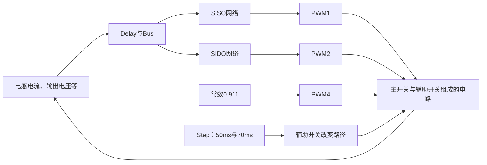

> 此记录保留提前运行的证据，当前不属于学习课程。单模式分析完成后再处理。

# 模式切换历史记录：暂缓

这一课只讲一件事：**负载一直要供电，电池充电任务在中间加入、最后退出。**

使用原文件 `change_SISO_SIDO_SISO.slx` 的工作副本，保留原电路、网络和参数，只增加记录信号的模块，实际运行80ms。数据来自这次原模型仿真，不是重新辨识或自己编的数据。

## 1. 先看时间表

| 时间 | 原模型设计的模式 | 希望发生什么 |
|---|---|---|
| 0～50ms | SISO：Vs→Vo | 电源供负载，电池基本不交换能量 |
| 50～70ms | SIDO：Vs→VB、Vo | 电源同时供负载和给电池充电 |
| 70～80ms | SISO：Vs→Vo | 退出充电，继续供负载 |

注意：这里的50/70ms是仿真测试安排，没有实现电池SOC判断或真实充电策略。电池端仍是原模型的理想72V电源，不等于已经完成真实电池充电系统。

## 2. 控制器在切什么

前面两个模式的理想开关规律，你已经学过：

| 模式 | S1 | S2 | S3 |
|---|---|---|---|
| SISO Vs→Vo | PWM(d) | 与S1同步 | 关断 |
| SIDO | PWM(d1) | PWM(d2)，d2<d1 | 关断 |

SISO由一个占空比决定储能/放能。SIDO多出给电池送能的阶段，所以两个占空比要配合。这是我们以后写固件要实现的模式逻辑。

**本次原SLX的接线更复杂，不能直接把上表当成它的每个Mosfet门极。** 实际核对到：

| 原模块 | 实际信号来源 |
|---|---|
| `Custom Neural Network1` | 测量量组成的Bus，输出进入PWM1 |
| `SIDO-shu150（效果较好）` | 同一个测量Bus，输出进入PWM2 |
| PWM1，100kHz | 直接驱动Mosfet1、Mosfet8 |
| PWM2，100kHz | 直接驱动Mosfet3 |
| PWM4，100kHz | 常数0.911，直接驱动Mosfet |
| Step1～Step8 | 50/70ms改变辅助Mosfet的开关状态，切换电路路径 |

两套网络都接着测量信号。这个原文件借助辅助开关切换有效电路路径，不是简单将两套网络输出接到一个软件选择器。还有未接入的网络模块，不能按模块名字认为它在控制电路。



## 3. 用C理解任务，不把它当成已完成的固件

```c
// 只表达理想模式逻辑；nn_*代表各模式已验证的控制函数。
// 这里没有驱动极性、死区、限流和故障保护，不能直接烧入样机。
if (test_time_ms < 50 || test_time_ms >= 70) {
    float d = nn_siso(iL, Vo);
    request_pwm(S1, d);
    request_pwm(S2, d);       // 同步PWM
    request_off(S3);
} else {
    float d1 = 0.911f;
    float d2 = nn_sido(iL, Vo);
    // d2范围及与d1的关系必须验证，不能默认网络永远满足。
    request_pwm(S1, d1);
    request_pwm(S2, d2);
    request_off(S3);
}
```

核心是：**测量仍然是那些量，模式决定该用什么控制规律、如何安排开关。** 原SLX辅助开关的映射还要核对，不能照着所有Mosfet数量采购实物器件。

## 4. 切换为什么有暂态

切换瞬间，新的控制规律面对的是上一模式留下的电感电流和电容电压，它们不会自动变成新模式的稳态值。

\[
i_L(t_2)-i_L(t_1)=\frac{1}{L}\int_{t_1}^{t_2}v_L(t)\,dt
\]

电感电流由一段时间内的电感电压积累改变；有限电压下不能瞬间跳变。输出电压同理：

\[
V_o(t_2)-V_o(t_1)=\frac{1}{C_o}\int_{t_1}^{t_2}(i_{\text{进入输出电容节点}}-i_{\text{负载}})\,dt
\]

右边就是“送来的电流减去负载拿走的电流”，差额给电容充放电。这两式用于理解切换暂态，不是本次重新求A、B。

## 5. 实际结果：先看电池，再看输出


从上到下：输出电压V、电感电流A、电池传感器电流A、输入电源电流A。虚线是50/70ms。

这张图有PWM纹波，曲线看着很厚；下面用指定时间窗口的采样平均值比较，避开刚切换的瞬间：

| 稳态观察窗口 | 输出平均V | 电感平均A | 电池传感器平均A | 输入平均A |
|---|---:|---:|---:|---:|
| 40～49ms，SISO | 190.624 | 151.380 | -0.00143 | 113.551 |
| 60～69ms，SIDO | 199.407 | 15.631 | -4.12211 | 12.043 |
| 75～79ms，SISO | 190.624 | 151.366 | -0.00142 | 113.541 |

电池传感器在原图中旋转180°，正方向对应电池向左侧电路送电；负值表示反向流入电池。因此中间段平均约4.12A充电，前后平均电流接近零。不能单凭瞬时电流某一点判断整个模式。

**结论要分清：模式切换和中间充电发生了；整个案例还没有达到合格的200V闭环复现。** 前后SISO段低约9.38V，而且电感平均电流约151A，明显需要核对。先前独立SISO案例能接近200V，不代表本切换模型的SISO段也正确。根因尚未定位，不能直接归咎于网络或某个开关。

原模型还报告启动时Divide3除零、重复Bus标签及闲置端口等警告；本次四路导出测量全部有限，不代表所有内部信号已经通过检查。下一步优先对照原检查版与独立SISO的网络、PWM及辅助路径，定位前后段问题，再推进其他切换。

## 6. 这一步怎样自查

- 能说出50/70ms各加入、退出了什么任务。
- 能解释为何SIDO要配合两个占空比。
- 能根据本模型的传感器方向解释负电流代表充电。
- 能区分“仿真跑完、模式切了”和“电压、电流、暂态全部达标”。

现在只需读懂这些。不要求你推导新的辨识模型，也不要求重训网络。

文件和运行入口见[切换案例说明](D:/Project/NN_EMPC_TPC/我们的科研工作区/主线工程/02_仿真工程/05_模式切换/README.md)。
